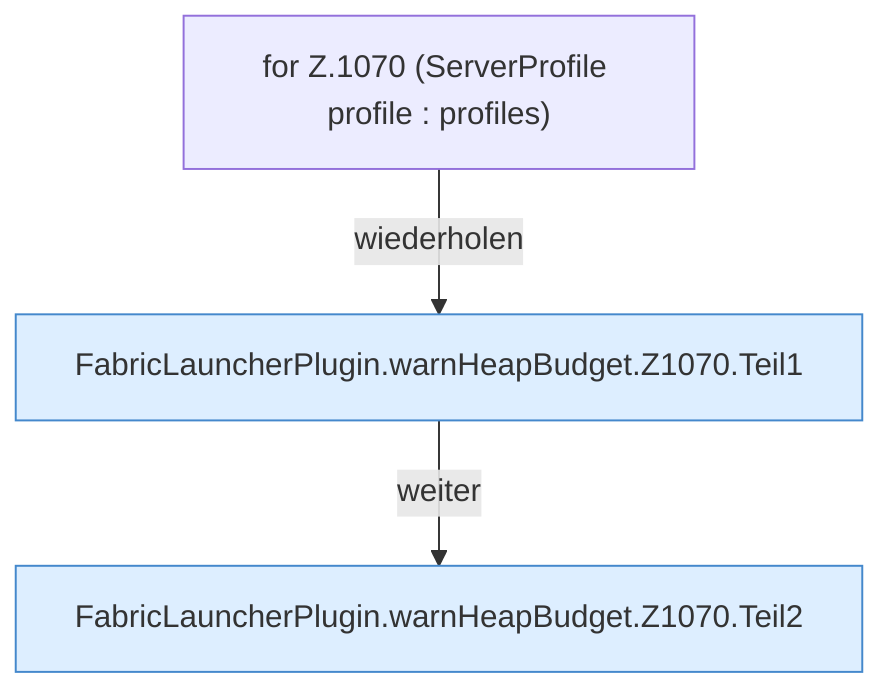

[[00 Start]] › [[Host-Betrieb]] › [[Speicher-Probe]] › [[FabricLauncherPlugin.warnHeapBudget]] › [[FabricLauncherPlugin.warnHeapBudget.Z1070]]

# FabricLauncherPlugin.warnHeapBudget.Z1070



```knoten
for Z.1070 (ServerProfile profile : profiles)
  Zeile 1070: Schleife `(ServerProfile profile : profiles)`.
FabricLauncherPlugin.warnHeapBudget.Z1070.Teil1
  Ein weiterer Abschnitt derselben Übersicht. Abschnitt 1 dieses Ablaufs, in Quellreihenfolge.
FabricLauncherPlugin.warnHeapBudget.Z1070.Teil2
  Ein weiterer Abschnitt derselben Übersicht. Abschnitt 2 dieses Ablaufs, in Quellreihenfolge.
```

> [!knoten]- Was die Blöcke tun
> - **for Z.1070 (ServerProfile profile : profiles)**: Zeile 1070: Schleife `(ServerProfile profile : profiles)`.
> - **FabricLauncherPlugin.warnHeapBudget.Z1070.Teil1**: Ein weiterer Abschnitt derselben Übersicht. Abschnitt 1 dieses Ablaufs, in Quellreihenfolge.
> - **FabricLauncherPlugin.warnHeapBudget.Z1070.Teil2**: Ein weiterer Abschnitt derselben Übersicht. Abschnitt 2 dieses Ablaufs, in Quellreihenfolge.

- Der Ablauf geht in [[Glossar#Zeile|Zeile]] 1070 weiter. Eine Ebene tiefer steht er genauer.
- Fortsetzung von `FabricLauncherPlugin.warnHeapBudget`.
