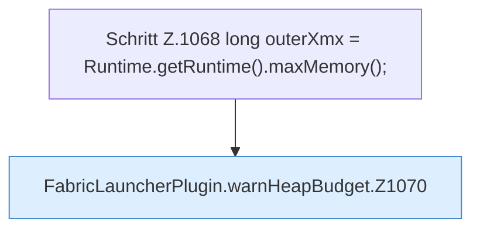

[[00 Start]] › [[Host-Betrieb]] › [[Speicher-Probe]] › [[FabricLauncherPlugin.warnHeapBudget]]

# FabricLauncherPlugin.warnHeapBudget

`FabricLauncherPlugin.warnHeapBudget(HostMemoryProbe.Snapshot snapshot)` [src/main/java/de/aichele/childlauncher/FabricLauncherPlugin.java:1067–1104](https://github.com/Sciddie/minecraft-serverhoster-plugin/blob/95b02b953b0b4c23673e900e021a7c3c844aa37d/src/main/java/de/aichele/childlauncher/FabricLauncherPlugin.java#L1067-L1104)



```knoten
Schritt Z.1068 long outerXmx = Runtime.getRuntime().maxMemory();
  Ein einzelner Arbeitsschritt, ohne eine weitere eigene [[Glossar#Funktion|Funktion]] aufzurufen. Das steht in [[Glossar#Zeile|Zeile]] 1068.
FabricLauncherPlugin.warnHeapBudget.Z1070
  Der Ablauf geht in [[Glossar#Zeile|Zeile]] 1070 weiter. Eine Ebene tiefer steht er genauer. Im [[Glossar#Quelltext|Quelltext]] heißt das `Z1070`.
```

> [!knoten]- Was die Blöcke tun
> - **Schritt Z.1068 long outerXmx = Runtime.getRuntime().maxMemory();**: Ein einzelner Arbeitsschritt, ohne eine weitere eigene [[Glossar#Funktion|Funktion]] aufzurufen. Das steht in [[Glossar#Zeile|Zeile]] 1068.
> - **FabricLauncherPlugin.warnHeapBudget.Z1070**: Der Ablauf geht in [[Glossar#Zeile|Zeile]] 1070 weiter. Eine Ebene tiefer steht er genauer. Im [[Glossar#Quelltext|Quelltext]] heißt das `Z1070`.

- Das [[Glossar#Plugin|Plugin]] warnt vor den Programmspeicher die Grenze.
