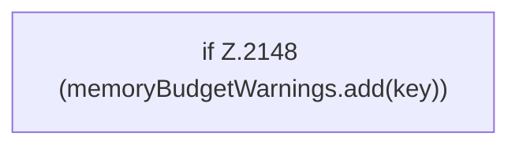

[[00 Start]] › [[Plugin-Kern]] › [[Lebenszyklus]] › [[FabricLauncherPlugin.warnOnce]]

# FabricLauncherPlugin.warnOnce

`FabricLauncherPlugin.warnOnce(String key, String message)` [src/main/java/de/aichele/childlauncher/FabricLauncherPlugin.java:2147–2149](https://github.com/Sciddie/minecraft-serverhoster-plugin/blob/95b02b953b0b4c23673e900e021a7c3c844aa37d/src/main/java/de/aichele/childlauncher/FabricLauncherPlugin.java#L2147-L2149)



```knoten
if Z.2148 (memoryBudgetWarnings.add(key))
  Hier fällt eine Entscheidung. Nur wenn sie zutrifft, geht es den Ja-Weg weiter. Das steht in [[Glossar#Zeile|Zeile]] 2148.
```

> [!knoten]- Was die Blöcke tun
> - **if Z.2148 (memoryBudgetWarnings.add(key))**: Hier fällt eine Entscheidung. Nur wenn sie zutrifft, geht es den Ja-Weg weiter. Das steht in [[Glossar#Zeile|Zeile]] 2148.

- Schreibt eine Warnung nur ein einziges Mal, damit das Protokoll nicht vollläuft.
