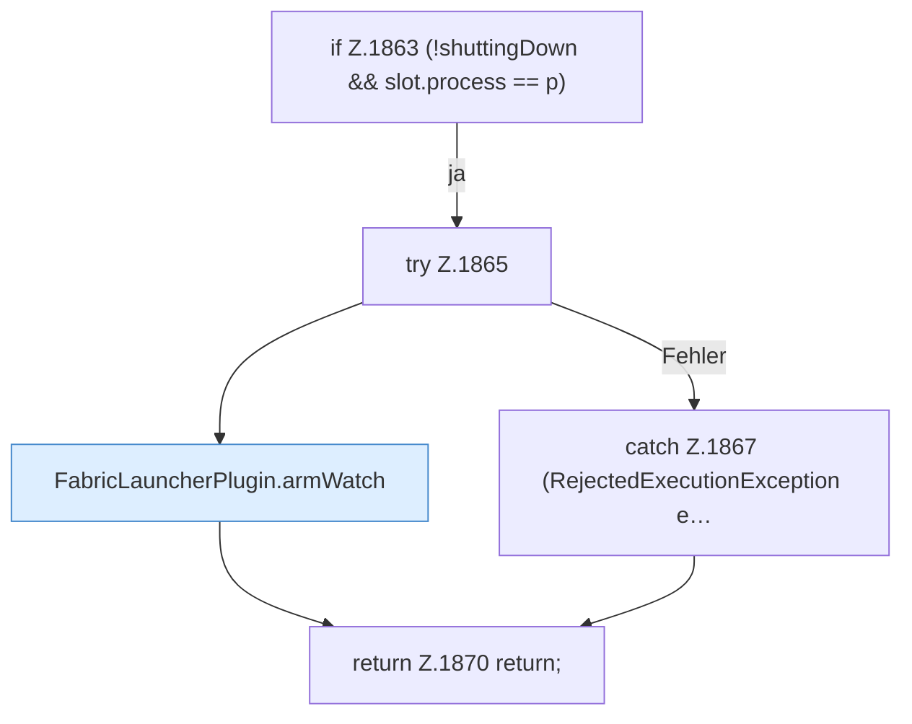

[[00 Start]] › [[Child-Prozess]] › [[Pipe-Watch]] › [[FabricLauncherPlugin.watch]] › [[FabricLauncherPlugin.watch.Teil1.Z1853.Z1858.Z1863]]

# FabricLauncherPlugin.watch.Teil1.Z1853.Z1858.Z1863



```knoten
if Z.1863 (!shuttingDown && slot.process == p)
  Zeile 1863: prüft `(!shuttingDown && slot.process == p)`.
try Z.1865
  Zeile 1865: Versuch. Der Fehlerpfad geht in catch.
FabricLauncherPlugin.armWatch
  Hängt die Überwachung an `armWatch`. Ruft `watch`.
catch Z.1867 (RejectedExecutionException e…
  Zeile 1867: fängt (RejectedExecutionException e….
return Z.1870 return;
  Zeile 1870: Rückgabe `return;`.
```

- Fortsetzung von `FabricLauncherPlugin.watch.Teil1.Z1853.Z1858`, Quellreihenfolge.
