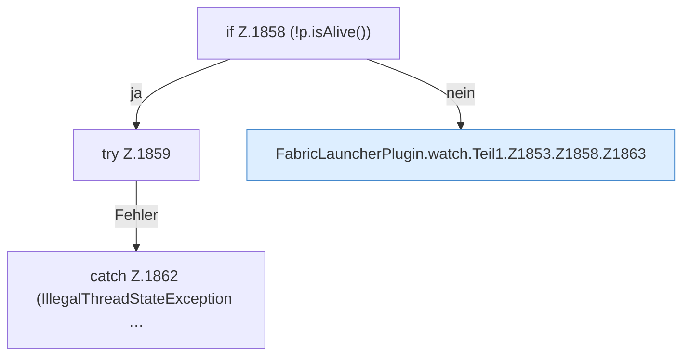

[[00 Start]] › [[Child-Prozess]] › [[Pipe-Watch]] › [[FabricLauncherPlugin.watch]] › [[FabricLauncherPlugin.watch.Teil1.Z1853.Z1858]]

# FabricLauncherPlugin.watch.Teil1.Z1853.Z1858

- Fortsetzung von `FabricLauncherPlugin.watch.Teil1.Z1853`, Quellreihenfolge.
