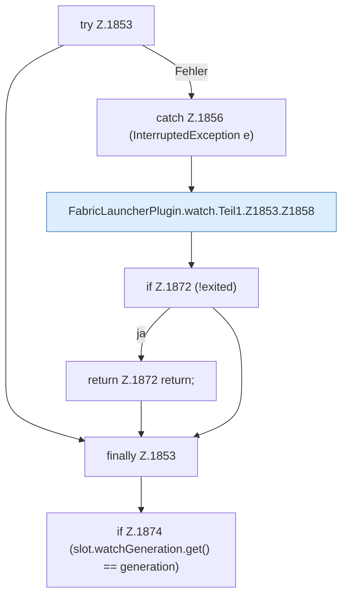

[[00 Start]] › [[Child-Prozess]] › [[Pipe-Watch]] › [[FabricLauncherPlugin.watch]] › [[FabricLauncherPlugin.watch.Teil1.Z1853]]

# FabricLauncherPlugin.watch.Teil1.Z1853

- Fortsetzung von `FabricLauncherPlugin.watch.Teil1`, Quellreihenfolge.
