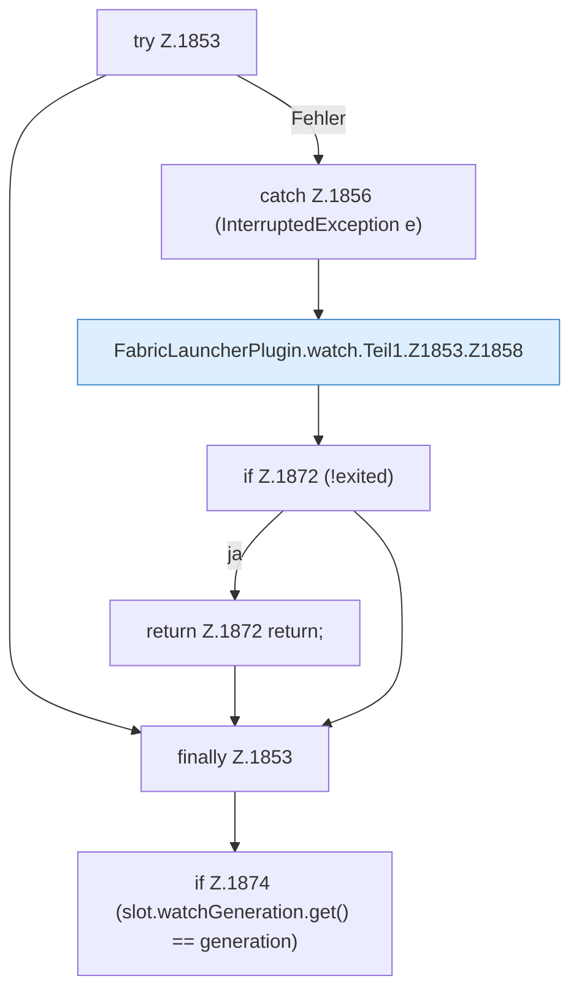

[[00 Start]] › [[Child-Prozess]] › [[Pipe-Watch]] › [[FabricLauncherPlugin.watch]] › [[FabricLauncherPlugin.watch.Teil1.Z1853]]

# FabricLauncherPlugin.watch.Teil1.Z1853



```knoten
try Z.1853
  Zeile 1853: Versuch. Der Fehlerpfad geht in catch.
catch Z.1856 (InterruptedException e)
  Zeile 1856: fängt (InterruptedException e).
FabricLauncherPlugin.watch.Teil1.Z1853.Z1858
  Der Ablauf geht in [[Glossar#Zeile|Zeile]] 1858 weiter. Eine Ebene tiefer steht er genauer. Fortsetzung des Ablaufs ab Zeile 1858.
if Z.1872 (!exited)
  Zeile 1872: prüft `(!exited)`.
return Z.1872 return;
  Zeile 1872: Rückgabe `return;`.
finally Z.1853
  Läuft danach immer, auch nach einem Fehler.
if Z.1874 (slot.watchGeneration.get() == generation)
  Zeile 1874: prüft `(slot.watchGeneration.get() == generation)`.
```

> [!knoten]- Was die Blöcke tun
> - **try Z.1853**: Zeile 1853: Versuch. Der Fehlerpfad geht in catch.
> - **catch Z.1856 (InterruptedException e)**: Zeile 1856: fängt (InterruptedException e).
> - **FabricLauncherPlugin.watch.Teil1.Z1853.Z1858**: Der Ablauf geht in [[Glossar#Zeile|Zeile]] 1858 weiter. Eine Ebene tiefer steht er genauer. Fortsetzung des Ablaufs ab Zeile 1858.
> - **if Z.1872 (!exited)**: Zeile 1872: prüft `(!exited)`.
> - **return Z.1872 return;**: Zeile 1872: Rückgabe `return;`.
> - **finally Z.1853**: Läuft danach immer, auch nach einem Fehler.
> - **if Z.1874 (slot.watchGeneration.get() == generation)**: Zeile 1874: prüft `(slot.watchGeneration.get() == generation)`.

- Der Ablauf geht in [[Glossar#Zeile|Zeile]] 1853 weiter. Eine Ebene tiefer steht er genauer.
- Fortsetzung von `FabricLauncherPlugin.watch.Teil1`.
