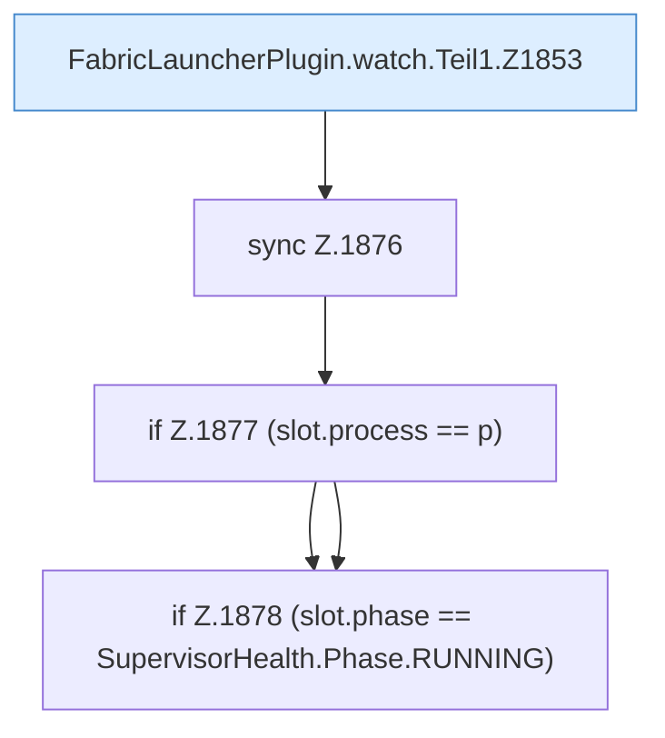

[[00 Start]] › [[Child-Prozess]] › [[Pipe-Watch]] › [[FabricLauncherPlugin.watch]] › [[FabricLauncherPlugin.watch.Teil1]]

# FabricLauncherPlugin.watch.Teil1



```knoten
FabricLauncherPlugin.watch.Teil1.Z1853
  Fortsetzung des Ablaufs ab Zeile 1853.
sync Z.1876
  Zeile 1876: synchronisierter Block.
if Z.1877 (slot.process == p)
  Zeile 1877: prüft `(slot.process == p)`.
if Z.1878 (slot.phase == SupervisorHealth.Phase.RUNNING)
  Zeile 1878: prüft `(slot.phase == SupervisorHealth.Phase.RUNNING)`.
```

- Fortsetzung von `FabricLauncherPlugin.watch`, Quellreihenfolge.
