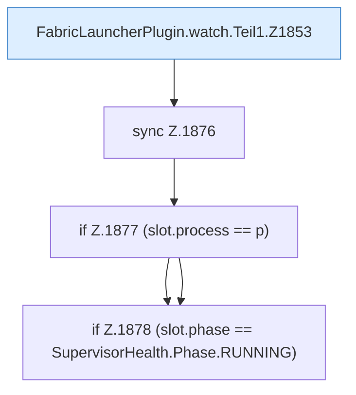

[[00 Start]] › [[Child-Prozess]] › [[Pipe-Watch]] › [[FabricLauncherPlugin.watch]] › [[FabricLauncherPlugin.watch.Teil1]]

# FabricLauncherPlugin.watch.Teil1

- Fortsetzung von `FabricLauncherPlugin.watch`, Quellreihenfolge.
