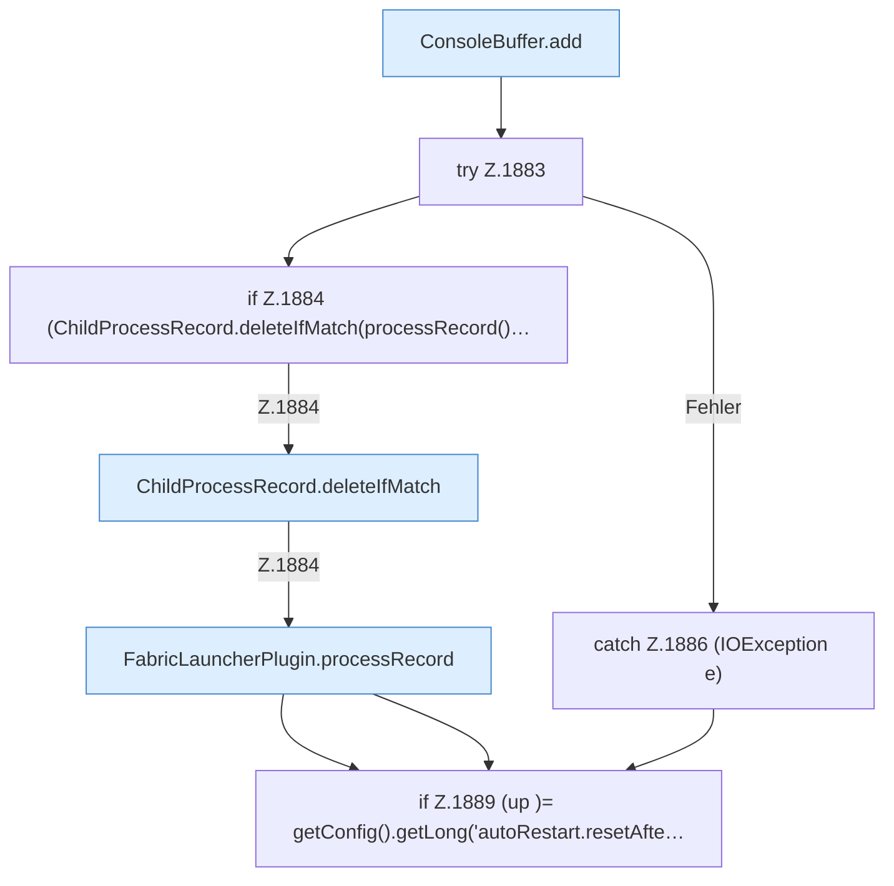

[[00 Start]] › [[Child-Prozess]] › [[Pipe-Watch]] › [[FabricLauncherPlugin.watch]] › [[FabricLauncherPlugin.watch.Teil2]]

# FabricLauncherPlugin.watch.Teil2



```knoten
ConsoleBuffer.add
  Dieser Teil fügt hinzu das. Fügt hinzu `add`.
try Z.1883
  Zeile 1883: Versuch. Der Fehlerpfad geht in catch.
if Z.1884 (ChildProcessRecord.deleteIfMatch(processRecord()…
  Zeile 1884: prüft `(ChildProcessRecord.deleteIfMatch(processRecord()…`.
ChildProcessRecord.deleteIfMatch
  Dieser Teil löscht hier einen Schritt. Eine Ebene tiefer steht er genauer. Löscht `deleteIfMatch`. Ruft `read`.
FabricLauncherPlugin.processRecord
  Baut den Merkzettel zum Programm: Nummer und die Prüfungen, ob es noch lebt. `processRecord` in `FabricLauncherPlugin.java`.
catch Z.1886 (IOException e)
  Zeile 1886: fängt (IOException e).
if Z.1889 (up )= getConfig().getLong('autoRestart.resetAfte…
  Zeile 1889: prüft `(up )= getConfig().getLong('autoRestart.resetAfte…`.
```

> [!knoten]- Was die Blöcke tun
> - **ConsoleBuffer.add**: Dieser Teil fügt hinzu das. Fügt hinzu `add`.
> - **try Z.1883**: Zeile 1883: Versuch. Der Fehlerpfad geht in catch.
> - **if Z.1884 (ChildProcessRecord.deleteIfMatch(processRecord()…**: Zeile 1884: prüft `(ChildProcessRecord.deleteIfMatch(processRecord()…`.
> - **ChildProcessRecord.deleteIfMatch**: Dieser Teil löscht hier einen Schritt. Eine Ebene tiefer steht er genauer. Löscht `deleteIfMatch`. Ruft `read`.
> - **FabricLauncherPlugin.processRecord**: Baut den Merkzettel zum Programm: Nummer und die Prüfungen, ob es noch lebt. `processRecord` in `FabricLauncherPlugin.java`.
> - **catch Z.1886 (IOException e)**: Zeile 1886: fängt (IOException e).
> - **if Z.1889 (up )= getConfig().getLong('autoRestart.resetAfte…**: Zeile 1889: prüft `(up )= getConfig().getLong('autoRestart.resetAfte…`.

- Ein weiterer Abschnitt derselben Übersicht.
- Fortsetzung von `FabricLauncherPlugin.watch`.
