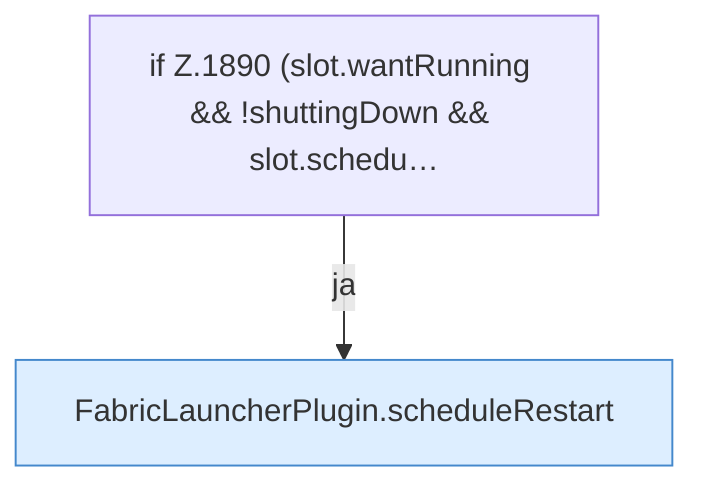

[[00 Start]] › [[Child-Prozess]] › [[Pipe-Watch]] › [[FabricLauncherPlugin.watch]] › [[FabricLauncherPlugin.watch.Teil3]]

# FabricLauncherPlugin.watch.Teil3



```knoten
if Z.1890 (slot.wantRunning && !shuttingDown && slot.schedu…
  Zeile 1890: prüft `(slot.wantRunning && !shuttingDown && slot.schedu…`.
FabricLauncherPlugin.scheduleRestart
  Wartet die [[Glossar#Pause|Pause]] und startet den [[Glossar#Spielserver|Spielserver]] dann neu. Am Anfang sind das fünf Sekunden, höchstens fünf Minuten. Plant `scheduleRestart`. Ruft `maxAttempts`, `mayRetry`, `notifyNtfy`.
```

> [!knoten]- Was die Blöcke tun
> - **if Z.1890 (slot.wantRunning && !shuttingDown && slot.schedu…**: Zeile 1890: prüft `(slot.wantRunning && !shuttingDown && slot.schedu…`.
> - **FabricLauncherPlugin.scheduleRestart**: Wartet die [[Glossar#Pause|Pause]] und startet den [[Glossar#Spielserver|Spielserver]] dann neu. Am Anfang sind das fünf Sekunden, höchstens fünf Minuten. Plant `scheduleRestart`. Ruft `maxAttempts`, `mayRetry`, `notifyNtfy`.

- Ein weiterer Abschnitt derselben Übersicht.
- Fortsetzung von `FabricLauncherPlugin.watch`.
