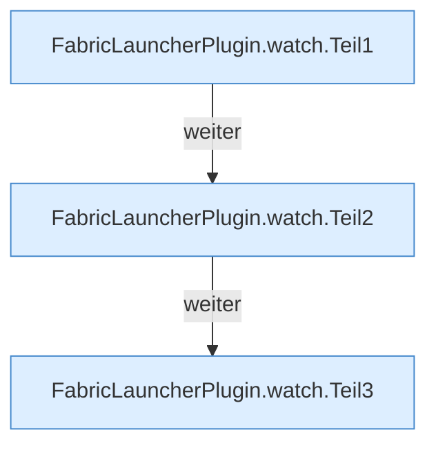

[[00 Start]] › [[Child-Prozess]] › [[Pipe-Watch]] › [[FabricLauncherPlugin.watch]]

# FabricLauncherPlugin.watch

`FabricLauncherPlugin.watch(ChildSlot slot, Process p, int token, int generation)` [src/main/java/de/aichele/childlauncher/FabricLauncherPlugin.java:1850–1891](https://github.com/Sciddie/minecraft-serverhoster-plugin/blob/95b02b953b0b4c23673e900e021a7c3c844aa37d/src/main/java/de/aichele/childlauncher/FabricLauncherPlugin.java#L1850-L1891)



```knoten
FabricLauncherPlugin.watch.Teil1
  Ein weiterer Abschnitt derselben Übersicht. Im [[Glossar#Quelltext|Quelltext]] heißt das `Teil1`.
FabricLauncherPlugin.watch.Teil2
  Ein weiterer Abschnitt derselben Übersicht. Im [[Glossar#Quelltext|Quelltext]] heißt das `Teil2`.
FabricLauncherPlugin.watch.Teil3
  Ein weiterer Abschnitt derselben Übersicht. Im [[Glossar#Quelltext|Quelltext]] heißt das `Teil3`.
```

> [!knoten]- Was die Blöcke tun
> - **FabricLauncherPlugin.watch.Teil1**: Ein weiterer Abschnitt derselben Übersicht. Im [[Glossar#Quelltext|Quelltext]] heißt das `Teil1`.
> - **FabricLauncherPlugin.watch.Teil2**: Ein weiterer Abschnitt derselben Übersicht. Im [[Glossar#Quelltext|Quelltext]] heißt das `Teil2`.
> - **FabricLauncherPlugin.watch.Teil3**: Ein weiterer Abschnitt derselben Übersicht. Im [[Glossar#Quelltext|Quelltext]] heißt das `Teil3`.

- Wartet, bis das Programm endet. Danach ist der Zustand aus. Wenn ein [[Glossar#Neustart|Neustart]] erlaubt ist, wird er angestoßen.
