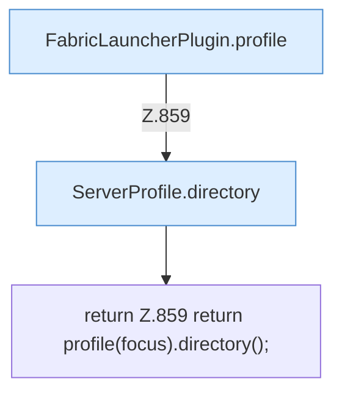

[[00 Start]] › [[Plugin-Kern]] › [[Fokus]] › [[FabricLauncherPlugin.workDir()]]

# FabricLauncherPlugin.workDir()

`FabricLauncherPlugin.workDir()` [src/main/java/de/aichele/childlauncher/FabricLauncherPlugin.java:859–859](https://github.com/Sciddie/minecraft-serverhoster-plugin/blob/95b02b953b0b4c23673e900e021a7c3c844aa37d/src/main/java/de/aichele/childlauncher/FabricLauncherPlugin.java#L859-L859)

- `workDir` in `src/main/java/de/aichele/childlauncher/FabricLauncherPlugin.java`
- Befund: toter Code, wahrscheinlich. src/main/java/de/aichele/childlauncher/FabricLauncherPlugin.java:859–859 kein Produktionsaufruf im Aufrufgraph
