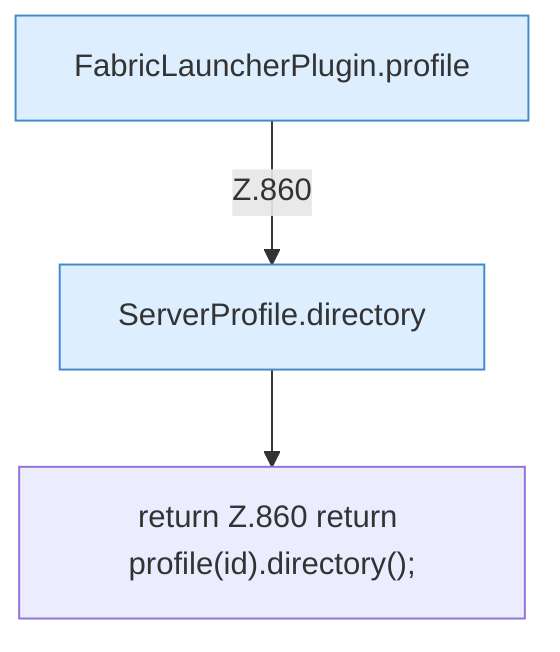

[[00 Start]] › [[Plugin-Kern]] › [[Fokus]] › [[FabricLauncherPlugin.workDir(String)]]

# FabricLauncherPlugin.workDir(String)

`FabricLauncherPlugin.workDir(String id)` [src/main/java/de/aichele/childlauncher/FabricLauncherPlugin.java:860–860](https://github.com/Sciddie/minecraft-serverhoster-plugin/blob/95b02b953b0b4c23673e900e021a7c3c844aa37d/src/main/java/de/aichele/childlauncher/FabricLauncherPlugin.java#L860-L860)



```knoten
FabricLauncherPlugin.profile
  `profile` in `FabricLauncherPlugin.java`.
ServerProfile.directory
  `directory` in `ServerProfile.java`.
return Z.860 return profile(id).directory();
  Zeile 860: Rückgabe `return profile(id).directory();`.
```

- `workDir` in `src/main/java/de/aichele/childlauncher/FabricLauncherPlugin.java`
