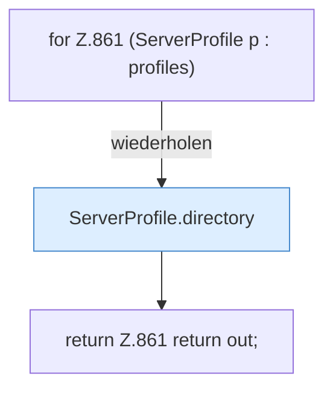

[[00 Start]] › [[Plugin-Kern]] › [[Fokus]] › [[FabricLauncherPlugin.workDirs]]

# FabricLauncherPlugin.workDirs

`FabricLauncherPlugin.workDirs()` [src/main/java/de/aichele/childlauncher/FabricLauncherPlugin.java:861–861](https://github.com/Sciddie/minecraft-serverhoster-plugin/blob/95b02b953b0b4c23673e900e021a7c3c844aa37d/src/main/java/de/aichele/childlauncher/FabricLauncherPlugin.java#L861-L861)



```knoten
for Z.861 (ServerProfile p : profiles)
  Zeile 861: Schleife `(ServerProfile p : profiles)`.
ServerProfile.directory
  `directory` in `ServerProfile.java`.
return Z.861 return out;
  Zeile 861: Rückgabe `return out;`.
```

- `workDirs` in `src/main/java/de/aichele/childlauncher/FabricLauncherPlugin.java`
- Befund: toter Code, sicher. src/main/java/de/aichele/childlauncher/FabricLauncherPlugin.java:861–861 kein Aufruf, kein Treffer in plugin.yml/UI/Strings
