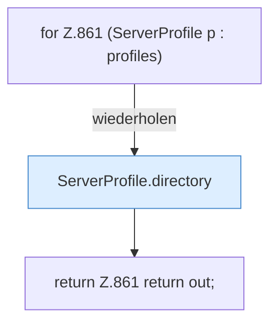

[[00 Start]] › [[Plugin-Kern]] › [[Fokus]] › [[FabricLauncherPlugin.workDirs]]

# FabricLauncherPlugin.workDirs

`FabricLauncherPlugin.workDirs()` [src/main/java/de/aichele/childlauncher/FabricLauncherPlugin.java:861–861](https://github.com/Sciddie/minecraft-serverhoster-plugin/blob/95b02b953b0b4c23673e900e021a7c3c844aa37d/src/main/java/de/aichele/childlauncher/FabricLauncherPlugin.java#L861-L861)



```knoten
for Z.861 (ServerProfile p : profiles)
  Dasselbe wird für jeden Eintrag wiederholt. Das steht in [[Glossar#Zeile|Zeile]] 861.
ServerProfile.directory
  Die Serverbeschreibung macht hier einen einzelnen Schritt. Eine Ebene tiefer steht er genauer. Im [[Glossar#Quelltext|Quelltext]] heißt das `directory`.
return Z.861 return out;
  Hier endet die [[Glossar#Funktion|Funktion]] und liefert ein Ergebnis zurück. Das steht in [[Glossar#Zeile|Zeile]] 861.
```

> [!knoten]- Was die Blöcke tun
> - **for Z.861 (ServerProfile p : profiles)**: Dasselbe wird für jeden Eintrag wiederholt. Das steht in [[Glossar#Zeile|Zeile]] 861.
> - **ServerProfile.directory**: Die Serverbeschreibung macht hier einen einzelnen Schritt. Eine Ebene tiefer steht er genauer. Im [[Glossar#Quelltext|Quelltext]] heißt das `directory`.
> - **return Z.861 return out;**: Hier endet die [[Glossar#Funktion|Funktion]] und liefert ein Ergebnis zurück. Das steht in [[Glossar#Zeile|Zeile]] 861.

- Die Ordner, in denen die Server arbeiten.
- Auffällig: im normalen Betrieb ruft das niemand auf. Das nennt man [[Glossar#Ungenutzt|Ungenutzt]].
