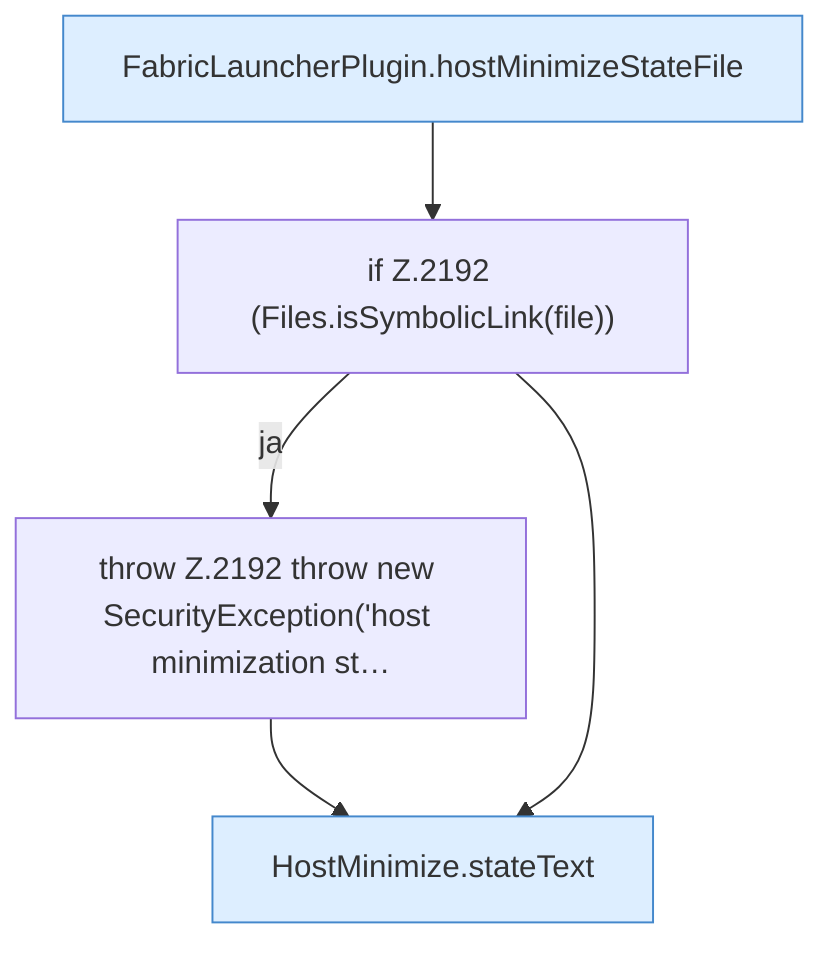

[[00 Start]] › [[Host-Betrieb]] › [[Host-Minimieren]] › [[Host-Minimieren.Teil1]] › [[FabricLauncherPlugin.writeHostMinimizeState]]

# FabricLauncherPlugin.writeHostMinimizeState

`FabricLauncherPlugin.writeHostMinimizeState(String status, String lobbyName, String backup, boolean restartRequired, String heapPrevious)` [src/main/java/de/aichele/childlauncher/FabricLauncherPlugin.java:2189–2194](https://github.com/Sciddie/minecraft-serverhoster-plugin/blob/95b02b953b0b4c23673e900e021a7c3c844aa37d/src/main/java/de/aichele/childlauncher/FabricLauncherPlugin.java#L2189-L2194)



```knoten
FabricLauncherPlugin.hostMinimizeStateFile
  Betrifft den Host `hostMinimizeStateFile`.
if Z.2192 (Files.isSymbolicLink(file))
  Zeile 2192: prüft `(Files.isSymbolicLink(file))`.
throw Z.2192 throw new SecurityException('host minimization st…
  Zeile 2192: Abbruch `throw new SecurityException('host minimization st…`.
HostMinimize.stateText
  Liefert den Zustand `stateText`.
```

- `writeHostMinimizeState` in `src/main/java/de/aichele/childlauncher/FabricLauncherPlugin.java`
