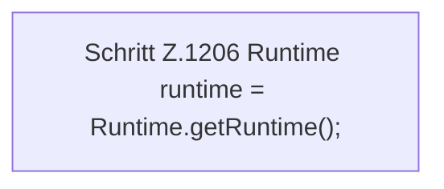

[[00 Start]] › [[Host-Betrieb]] › [[Speicher-Stopp]] › [[FabricLauncherPlugin.writeMemoryIncidentReport]] › [[FabricLauncherPlugin.writeMemoryIncidentReport.Teil1]]

# FabricLauncherPlugin.writeMemoryIncidentReport.Teil1



```knoten
Schritt Z.1206 Runtime runtime = Runtime.getRuntime();
  Zeile 1206: fragt die JVM-Laufzeit. `Runtime runtime = Runtime.getRuntime();`
```

- Fortsetzung von `FabricLauncherPlugin.writeMemoryIncidentReport`, Quellreihenfolge.
