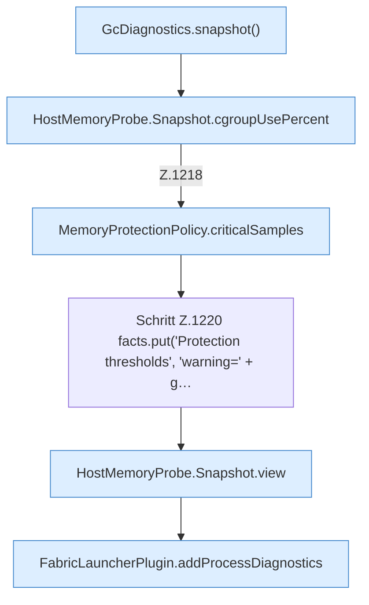

[[00 Start]] › [[Host-Betrieb]] › [[Speicher-Stopp]] › [[FabricLauncherPlugin.writeMemoryIncidentReport]] › [[FabricLauncherPlugin.writeMemoryIncidentReport.Teil2]]

# FabricLauncherPlugin.writeMemoryIncidentReport.Teil2



```knoten
GcDiagnostics.snapshot()
  Dieser Teil macht hier einen einzelnen Schritt. Eine Ebene tiefer steht er genauer. `snapshot` in `GcDiagnostics.java`. Ruft `snapshot`.
HostMemoryProbe.Snapshot.cgroupUsePercent
  Die Messung macht hier einen einzelnen Schritt. Eine Ebene tiefer steht er genauer. `cgroupUsePercent` in `HostMemoryProbe.java`.
MemoryProtectionPolicy.criticalSamples
  Dieser Teil macht hier einen einzelnen Schritt. Eine Ebene tiefer steht er genauer. `criticalSamples` in `MemoryProtectionPolicy.java`.
Schritt Z.1220 facts.put('Protection thresholds', 'warning=' + g…
  Zeile 1220: `facts.put('Protection thresholds', 'warning=' + g…`
HostMemoryProbe.Snapshot.view
  Die Messung macht hier einen einzelnen Schritt. Eine Ebene tiefer steht er genauer. Liefert die Sicht `view`.
FabricLauncherPlugin.addProcessDiagnostics
  Das [[Glossar#Plugin|Plugin]] fügt hinzu das laufende Programm die [[Glossar#Diagnose|Diagnose]]. Fügt hinzu `addProcessDiagnostics`. Ruft `snapshot`, `jcmd`.
```

> [!knoten]- Was die Blöcke tun
> - **GcDiagnostics.snapshot()**: Dieser Teil macht hier einen einzelnen Schritt. Eine Ebene tiefer steht er genauer. `snapshot` in `GcDiagnostics.java`. Ruft `snapshot`.
> - **HostMemoryProbe.Snapshot.cgroupUsePercent**: Die Messung macht hier einen einzelnen Schritt. Eine Ebene tiefer steht er genauer. `cgroupUsePercent` in `HostMemoryProbe.java`.
> - **MemoryProtectionPolicy.criticalSamples**: Dieser Teil macht hier einen einzelnen Schritt. Eine Ebene tiefer steht er genauer. `criticalSamples` in `MemoryProtectionPolicy.java`.
> - **Schritt Z.1220 facts.put('Protection thresholds', 'warning=' + g…**: Zeile 1220: `facts.put('Protection thresholds', 'warning=' + g…`
> - **HostMemoryProbe.Snapshot.view**: Die Messung macht hier einen einzelnen Schritt. Eine Ebene tiefer steht er genauer. Liefert die Sicht `view`.
> - **FabricLauncherPlugin.addProcessDiagnostics**: Das [[Glossar#Plugin|Plugin]] fügt hinzu das laufende Programm die [[Glossar#Diagnose|Diagnose]]. Fügt hinzu `addProcessDiagnostics`. Ruft `snapshot`, `jcmd`.

- Ein weiterer Abschnitt derselben Übersicht.
- Fortsetzung von `FabricLauncherPlugin.writeMemoryIncidentReport`.
