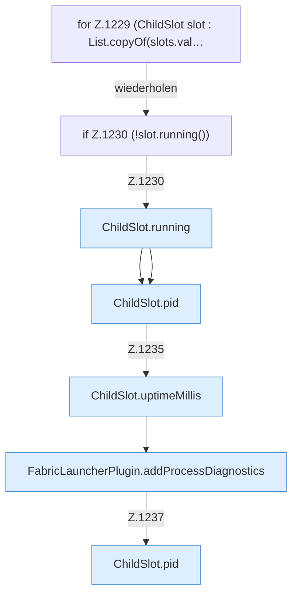

[[00 Start]] › [[Host-Betrieb]] › [[Speicher-Stopp]] › [[FabricLauncherPlugin.writeMemoryIncidentReport]] › [[FabricLauncherPlugin.writeMemoryIncidentReport.Teil3.Z1229]]

# FabricLauncherPlugin.writeMemoryIncidentReport.Teil3.Z1229



```knoten
for Z.1229 (ChildSlot slot : List.copyOf(slots.val…
  Zeile 1229: Schleife `(ChildSlot slot : List.copyOf(slots.val…`.
if Z.1230 (!slot.running())
  Zeile 1230: prüft `(!slot.running())`.
ChildSlot.running
  Dieser Teil prüft, ob läuft, das. Sagt, ob der [[Glossar#Prozess|Prozess]] läuft `running`.
ChildSlot.pid
  Dieser Teil macht hier einen einzelnen Schritt. Eine Ebene tiefer steht er genauer. Liefert die Prozessnummer `pid`.
ChildSlot.uptimeMillis
  Dieser Teil kümmert sich um die Zeit. Liefert die Laufzeit `uptimeMillis`. Ruft `running`.
FabricLauncherPlugin.addProcessDiagnostics
  Das [[Glossar#Plugin|Plugin]] fügt hinzu das laufende Programm die [[Glossar#Diagnose|Diagnose]]. Fügt hinzu `addProcessDiagnostics`. Ruft `snapshot`, `jcmd`.
```

> [!knoten]- Was die Blöcke tun
> - **for Z.1229 (ChildSlot slot : List.copyOf(slots.val…**: Zeile 1229: Schleife `(ChildSlot slot : List.copyOf(slots.val…`.
> - **if Z.1230 (!slot.running())**: Zeile 1230: prüft `(!slot.running())`.
> - **ChildSlot.running**: Dieser Teil prüft, ob läuft, das. Sagt, ob der [[Glossar#Prozess|Prozess]] läuft `running`.
> - **ChildSlot.pid**: Dieser Teil macht hier einen einzelnen Schritt. Eine Ebene tiefer steht er genauer. Liefert die Prozessnummer `pid`.
> - **ChildSlot.uptimeMillis**: Dieser Teil kümmert sich um die Zeit. Liefert die Laufzeit `uptimeMillis`. Ruft `running`.
> - **FabricLauncherPlugin.addProcessDiagnostics**: Das [[Glossar#Plugin|Plugin]] fügt hinzu das laufende Programm die [[Glossar#Diagnose|Diagnose]]. Fügt hinzu `addProcessDiagnostics`. Ruft `snapshot`, `jcmd`.

- Der Ablauf geht in [[Glossar#Zeile|Zeile]] 1229 weiter. Eine Ebene tiefer steht er genauer.
- Fortsetzung von `FabricLauncherPlugin.writeMemoryIncidentReport.Teil3`.
