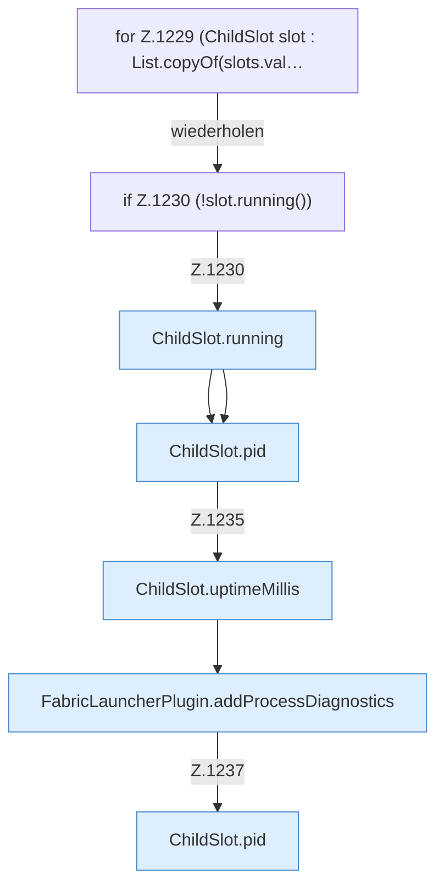

[[00 Start]] › [[Host-Betrieb]] › [[Speicher-Stopp]] › [[FabricLauncherPlugin.writeMemoryIncidentReport]] › [[FabricLauncherPlugin.writeMemoryIncidentReport.Teil3.Z1229]]

# FabricLauncherPlugin.writeMemoryIncidentReport.Teil3.Z1229



```knoten
for Z.1229 (ChildSlot slot : List.copyOf(slots.val…
  Zeile 1229: Schleife `(ChildSlot slot : List.copyOf(slots.val…`.
if Z.1230 (!slot.running())
  Zeile 1230: prüft `(!slot.running())`.
ChildSlot.running
  Sagt, ob der Prozess läuft `running`.
ChildSlot.pid
  Liefert die Prozessnummer `pid`.
ChildSlot.uptimeMillis
  Liefert die Laufzeit `uptimeMillis`. Ruft `running`.
FabricLauncherPlugin.addProcessDiagnostics
  Fügt hinzu `addProcessDiagnostics`. Ruft `snapshot`, `jcmd`.
```

- Fortsetzung von `FabricLauncherPlugin.writeMemoryIncidentReport.Teil3`, Quellreihenfolge.
