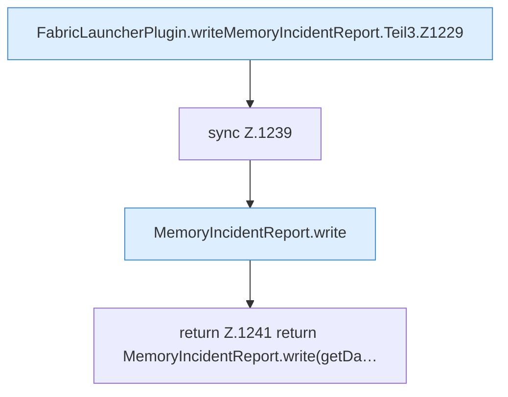

[[00 Start]] › [[Host-Betrieb]] › [[Speicher-Stopp]] › [[FabricLauncherPlugin.writeMemoryIncidentReport]] › [[FabricLauncherPlugin.writeMemoryIncidentReport.Teil3]]

# FabricLauncherPlugin.writeMemoryIncidentReport.Teil3

- Fortsetzung von `FabricLauncherPlugin.writeMemoryIncidentReport`, Quellreihenfolge.
