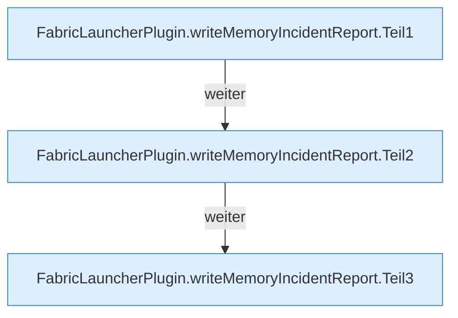

[[00 Start]] › [[Host-Betrieb]] › [[Speicher-Stopp]] › [[FabricLauncherPlugin.writeMemoryIncidentReport]]

# FabricLauncherPlugin.writeMemoryIncidentReport

`FabricLauncherPlugin.writeMemoryIncidentReport(HostMemoryProbe.Snapshot trigger, Map<String, String> warningResults)` [src/main/java/de/aichele/childlauncher/FabricLauncherPlugin.java:1203–1242](https://github.com/Sciddie/minecraft-serverhoster-plugin/blob/95b02b953b0b4c23673e900e021a7c3c844aa37d/src/main/java/de/aichele/childlauncher/FabricLauncherPlugin.java#L1203-L1242)



```knoten
FabricLauncherPlugin.writeMemoryIncidentReport.Teil1
  Ein weiterer Abschnitt derselben Übersicht. Im [[Glossar#Quelltext|Quelltext]] heißt das `Teil1`.
FabricLauncherPlugin.writeMemoryIncidentReport.Teil2
  Ein weiterer Abschnitt derselben Übersicht. Im [[Glossar#Quelltext|Quelltext]] heißt das `Teil2`.
FabricLauncherPlugin.writeMemoryIncidentReport.Teil3
  Ein weiterer Abschnitt derselben Übersicht. Im [[Glossar#Quelltext|Quelltext]] heißt das `Teil3`.
```

> [!knoten]- Was die Blöcke tun
> - **FabricLauncherPlugin.writeMemoryIncidentReport.Teil1**: Ein weiterer Abschnitt derselben Übersicht. Im [[Glossar#Quelltext|Quelltext]] heißt das `Teil1`.
> - **FabricLauncherPlugin.writeMemoryIncidentReport.Teil2**: Ein weiterer Abschnitt derselben Übersicht. Im [[Glossar#Quelltext|Quelltext]] heißt das `Teil2`.
> - **FabricLauncherPlugin.writeMemoryIncidentReport.Teil3**: Ein weiterer Abschnitt derselben Übersicht. Im [[Glossar#Quelltext|Quelltext]] heißt das `Teil3`.

- Das [[Glossar#Plugin|Plugin]] schreibt den [[Glossar#Arbeitsspeicher|Arbeitsspeicher]] den [[Glossar#Vorfall|Vorfall]] den Bericht.
