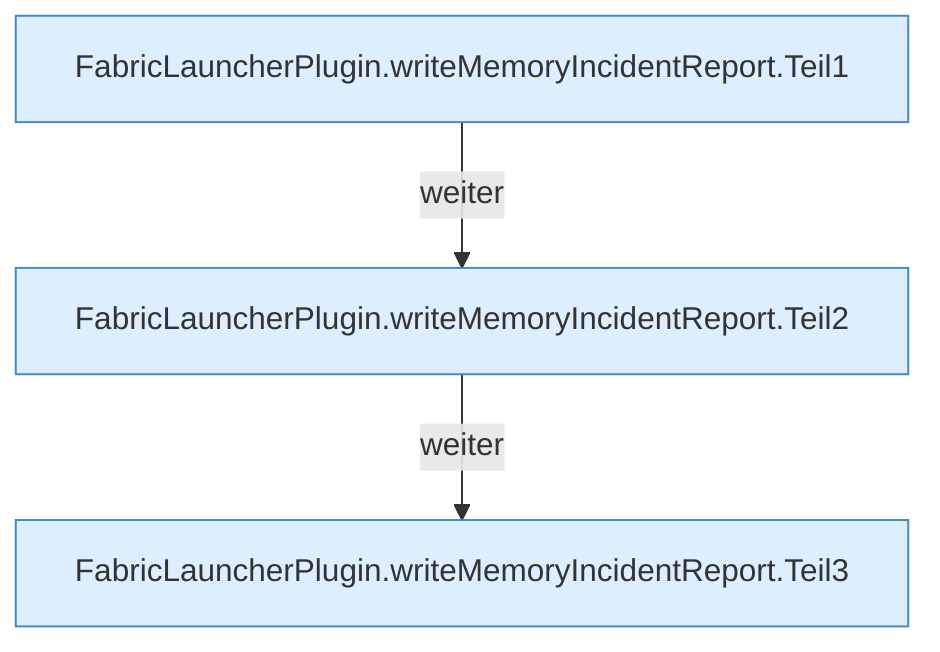

[[00 Start]] › [[Host-Betrieb]] › [[Speicher-Stopp]] › [[FabricLauncherPlugin.writeMemoryIncidentReport]]

# FabricLauncherPlugin.writeMemoryIncidentReport

`FabricLauncherPlugin.writeMemoryIncidentReport(HostMemoryProbe.Snapshot trigger, Map<String, String> warningResults)` [src/main/java/de/aichele/childlauncher/FabricLauncherPlugin.java:1203–1242](https://github.com/Sciddie/minecraft-serverhoster-plugin/blob/95b02b953b0b4c23673e900e021a7c3c844aa37d/src/main/java/de/aichele/childlauncher/FabricLauncherPlugin.java#L1203-L1242)



```knoten
FabricLauncherPlugin.writeMemoryIncidentReport.Teil1
  Abschnitt 1 dieses Ablaufs, in Quellreihenfolge.
FabricLauncherPlugin.writeMemoryIncidentReport.Teil2
  Abschnitt 2 dieses Ablaufs, in Quellreihenfolge.
FabricLauncherPlugin.writeMemoryIncidentReport.Teil3
  Abschnitt 3 dieses Ablaufs, in Quellreihenfolge.
```

- `writeMemoryIncidentReport` in `src/main/java/de/aichele/childlauncher/FabricLauncherPlugin.java`
