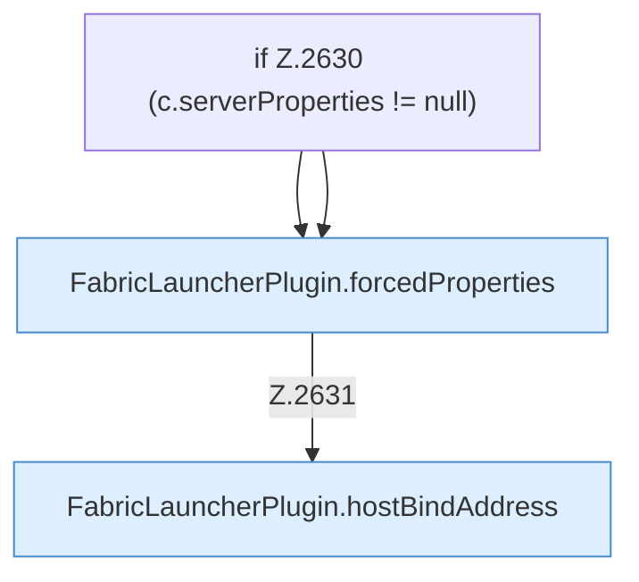

[[00 Start]] › [[Plugin-Kern]] › [[Properties]] › [[FabricLauncherPlugin.writeProperties]] › [[FabricLauncherPlugin.writeProperties.Teil1]]

# FabricLauncherPlugin.writeProperties.Teil1



```knoten
if Z.2630 (c.serverProperties != null)
  Zeile 2630: prüft `(c.serverProperties != null)`.
FabricLauncherPlugin.forcedProperties
  Erzwingt `forcedProperties`. Ruft `effectiveBindAddress`.
FabricLauncherPlugin.hostBindAddress
  Betrifft den Host `hostBindAddress`.
```

- Fortsetzung von `FabricLauncherPlugin.writeProperties`, Quellreihenfolge.
