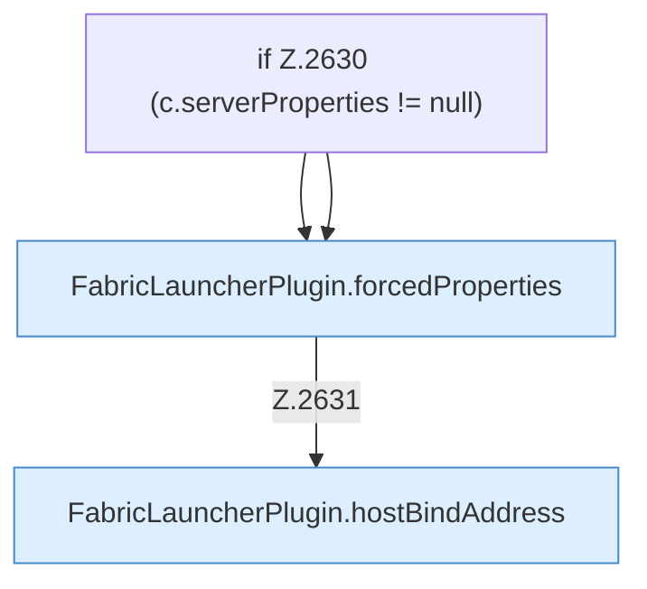

[[00 Start]] › [[Plugin-Kern]] › [[Properties]] › [[FabricLauncherPlugin.writeProperties]] › [[FabricLauncherPlugin.writeProperties.Teil1]]

# FabricLauncherPlugin.writeProperties.Teil1



```knoten
if Z.2630 (c.serverProperties != null)
  Zeile 2630: prüft `(c.serverProperties != null)`.
FabricLauncherPlugin.forcedProperties
  Werte, die das [[Glossar#Plugin|Plugin]] in der Eigenschaftsdatei fest setzt, auch wenn dort etwas anderes steht. Erzwingt `forcedProperties`. Ruft `effectiveBindAddress`.
FabricLauncherPlugin.hostBindAddress
  Die Adresse, unter der der [[Glossar#Host|Host]] selbst erreichbar sein soll. Betrifft den Host `hostBindAddress`.
```

> [!knoten]- Was die Blöcke tun
> - **if Z.2630 (c.serverProperties != null)**: Zeile 2630: prüft `(c.serverProperties != null)`.
> - **FabricLauncherPlugin.forcedProperties**: Werte, die das [[Glossar#Plugin|Plugin]] in der Eigenschaftsdatei fest setzt, auch wenn dort etwas anderes steht. Erzwingt `forcedProperties`. Ruft `effectiveBindAddress`.
> - **FabricLauncherPlugin.hostBindAddress**: Die Adresse, unter der der [[Glossar#Host|Host]] selbst erreichbar sein soll. Betrifft den Host `hostBindAddress`.

- Ein weiterer Abschnitt derselben Übersicht.
- Fortsetzung von `FabricLauncherPlugin.writeProperties`.
