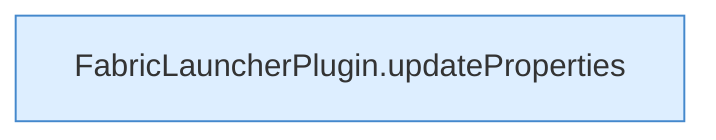

[[00 Start]] › [[Plugin-Kern]] › [[Properties]] › [[FabricLauncherPlugin.writeProperties]] › [[FabricLauncherPlugin.writeProperties.Teil2]]

# FabricLauncherPlugin.writeProperties.Teil2

- Fortsetzung von `FabricLauncherPlugin.writeProperties`, Quellreihenfolge.
