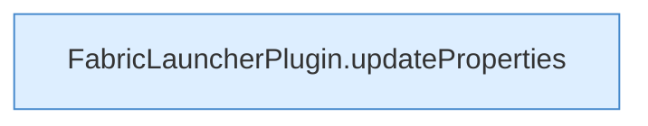

[[00 Start]] › [[Plugin-Kern]] › [[Properties]] › [[FabricLauncherPlugin.writeProperties]] › [[FabricLauncherPlugin.writeProperties.Teil2]]

# FabricLauncherPlugin.writeProperties.Teil2



```knoten
FabricLauncherPlugin.updateProperties
  Das [[Glossar#Plugin|Plugin]] ändert die Eigenschaften. Aktualisiert `updateProperties`. Ruft `update`.
```

> [!knoten]- Was die Blöcke tun
> - **FabricLauncherPlugin.updateProperties**: Das [[Glossar#Plugin|Plugin]] ändert die Eigenschaften. Aktualisiert `updateProperties`. Ruft `update`.

- Ein weiterer Abschnitt derselben Übersicht.
- Fortsetzung von `FabricLauncherPlugin.writeProperties`.
