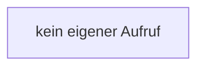

[[00 Start]] › [[Host-Betrieb]] › [[Speicher-Messung]] › [[GcDiagnostics]] › [[GcDiagnostics.GcDiagnostics]]

# GcDiagnostics.GcDiagnostics

`GcDiagnostics.GcDiagnostics()` [src/main/java/de/aichele/childlauncher/GcDiagnostics.java:14–14](https://github.com/Sciddie/minecraft-serverhoster-plugin/blob/95b02b953b0b4c23673e900e021a7c3c844aa37d/src/main/java/de/aichele/childlauncher/GcDiagnostics.java#L14-L14)

- `GcDiagnostics` in `src/main/java/de/aichele/childlauncher/GcDiagnostics.java`
