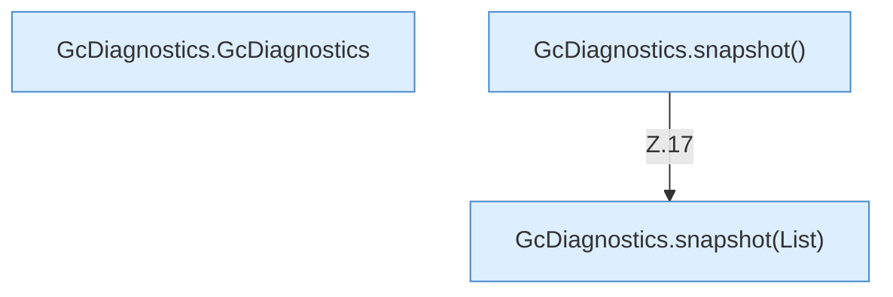

[[00 Start]] › [[Host-Betrieb]] › [[Speicher-Messung]] › [[GcDiagnostics]]

# GcDiagnostics



```knoten
GcDiagnostics.GcDiagnostics
  Dieser Teil kümmert sich um die [[Glossar#Diagnose|Diagnose]]. Im [[Glossar#Quelltext|Quelltext]] heißt das `GcDiagnostics`.
GcDiagnostics.snapshot()
  Dieser Teil macht hier einen einzelnen Schritt. Eine Ebene tiefer steht er genauer. Im [[Glossar#Quelltext|Quelltext]] heißt das `snapshot()`.
GcDiagnostics.snapshot(List)
  Dieser Teil macht hier einen einzelnen Schritt. Eine Ebene tiefer steht er genauer. Im [[Glossar#Quelltext|Quelltext]] heißt das `snapshot(List)`.
```

> [!knoten]- Was die Blöcke tun
> - **GcDiagnostics.GcDiagnostics**: Dieser Teil kümmert sich um die [[Glossar#Diagnose|Diagnose]]. Im [[Glossar#Quelltext|Quelltext]] heißt das `GcDiagnostics`.
> - **GcDiagnostics.snapshot()**: Dieser Teil macht hier einen einzelnen Schritt. Eine Ebene tiefer steht er genauer. Im [[Glossar#Quelltext|Quelltext]] heißt das `snapshot()`.
> - **GcDiagnostics.snapshot(List)**: Dieser Teil macht hier einen einzelnen Schritt. Eine Ebene tiefer steht er genauer. Im [[Glossar#Quelltext|Quelltext]] heißt das `snapshot(List)`.

- Sammelt Angaben zur automatischen Speicherbereinigung für den Text eines [[Glossar#Vorfall|Vorfalls]].
