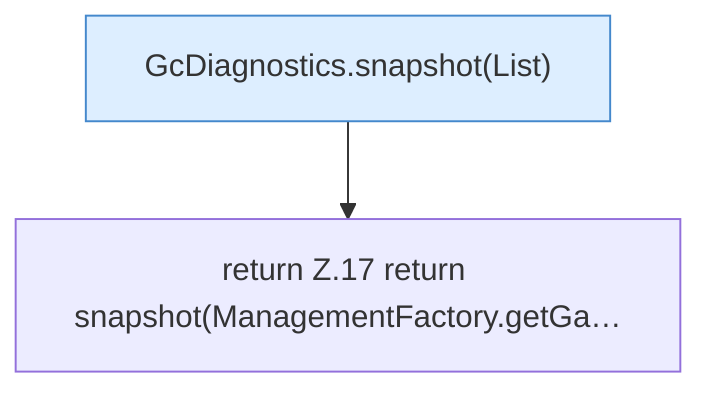

[[00 Start]] › [[Host-Betrieb]] › [[Speicher-Messung]] › [[GcDiagnostics]] › [[GcDiagnostics.snapshot()]]

# GcDiagnostics.snapshot()

`GcDiagnostics.snapshot()` [src/main/java/de/aichele/childlauncher/GcDiagnostics.java:16–18](https://github.com/Sciddie/minecraft-serverhoster-plugin/blob/95b02b953b0b4c23673e900e021a7c3c844aa37d/src/main/java/de/aichele/childlauncher/GcDiagnostics.java#L16-L18)

- `snapshot` in `src/main/java/de/aichele/childlauncher/GcDiagnostics.java`
