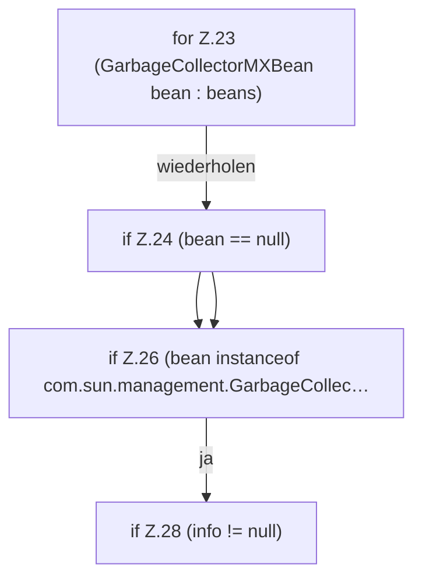

[[00 Start]] › [[Host-Betrieb]] › [[Speicher-Messung]] › [[GcDiagnostics]] › [[GcDiagnostics.snapshot(List)]] › [[GcDiagnostics.snapshot(List).Z23]]

# GcDiagnostics.snapshot(List).Z23



```knoten
for Z.23 (GarbageCollectorMXBean bean : beans)
  Zeile 23: Schleife `(GarbageCollectorMXBean bean : beans)`.
if Z.24 (bean == null)
  Zeile 24: prüft `(bean == null)`.
if Z.26 (bean instanceof com.sun.management.GarbageCollec…
  Zeile 26: prüft `(bean instanceof com.sun.management.GarbageCollec…`.
if Z.28 (info != null)
  Zeile 28: prüft `(info != null)`.
```

- Fortsetzung von `GcDiagnostics.snapshot(List)`, Quellreihenfolge.
