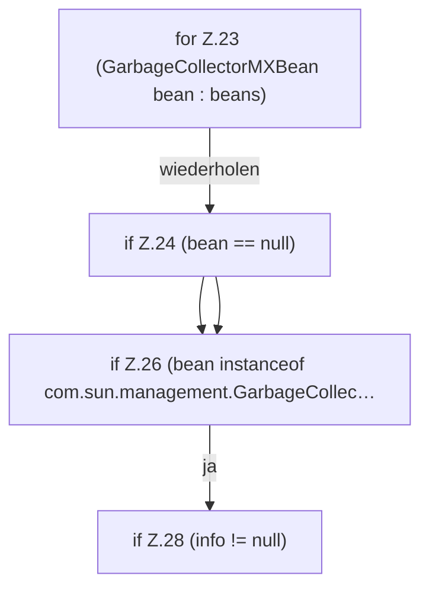

[[00 Start]] › [[Host-Betrieb]] › [[Speicher-Messung]] › [[GcDiagnostics]] › [[GcDiagnostics.snapshot(List)]] › [[GcDiagnostics.snapshot(List).Z23]]

# GcDiagnostics.snapshot(List).Z23

- Fortsetzung von `GcDiagnostics.snapshot(List)`, Quellreihenfolge.
