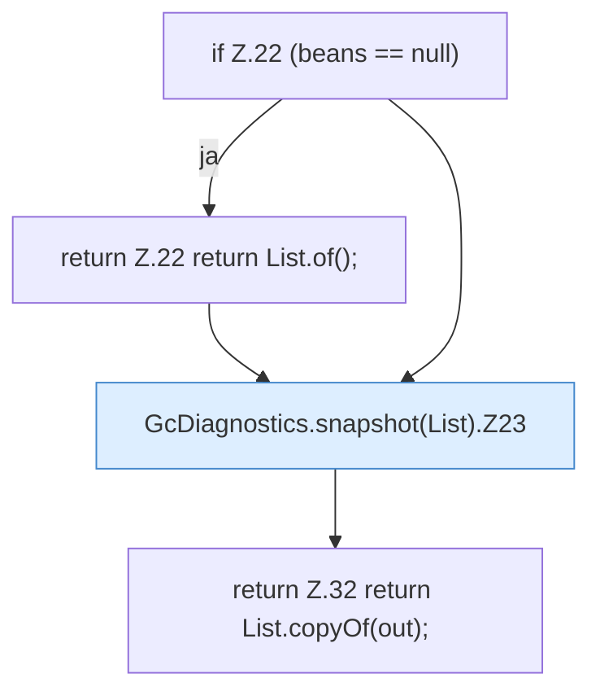

[[00 Start]] › [[Host-Betrieb]] › [[Speicher-Messung]] › [[GcDiagnostics]] › [[GcDiagnostics.snapshot(List)]]

# GcDiagnostics.snapshot(List)

`GcDiagnostics.snapshot(List<GarbageCollectorMXBean> beans)` [src/main/java/de/aichele/childlauncher/GcDiagnostics.java:20–33](https://github.com/Sciddie/minecraft-serverhoster-plugin/blob/95b02b953b0b4c23673e900e021a7c3c844aa37d/src/main/java/de/aichele/childlauncher/GcDiagnostics.java#L20-L33)



```knoten
if Z.22 (beans == null)
  Zeile 22: prüft `(beans == null)`.
return Z.22 return List.of();
  Zeile 22: Rückgabe `return List.of();`.
GcDiagnostics.snapshot(List).Z23
  Fortsetzung des Ablaufs ab Zeile 23.
return Z.32 return List.copyOf(out);
  Zeile 32: Rückgabe `return List.copyOf(out);`.
```

- `snapshot` in `src/main/java/de/aichele/childlauncher/GcDiagnostics.java`
