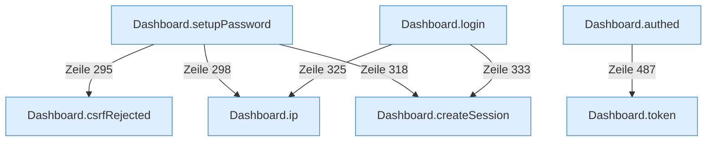

[[00 Start]] › [[Dashboard-HTTP]] › [[HTTP-Auth]]

# HTTP-Auth



```knoten
Dashboard.ip
  Die [[Glossar#Web-Schnittstelle|Web-Schnittstelle]] macht hier einen einzelnen Schritt. Eine Ebene tiefer steht er genauer.
Dashboard.createSession
  Die [[Glossar#Web-Schnittstelle|Web-Schnittstelle]] legt an die [[Glossar#Anmeldung|Anmeldung]].
Dashboard.setupPassword
  Legt das Passwort der [[Glossar#Bedienseite|Bedienseite]] fest, wenn noch keines da ist.
Dashboard.login
  Prüft das Passwort und merkt die [[Glossar#Anmeldung|Anmeldung]].
Dashboard.token
  Die [[Glossar#Web-Schnittstelle|Web-Schnittstelle]] macht hier einen einzelnen Schritt. Eine Ebene tiefer steht er genauer.
Dashboard.authed
  Die [[Glossar#Web-Schnittstelle|Web-Schnittstelle]] macht hier einen einzelnen Schritt. Eine Ebene tiefer steht er genauer.
Dashboard.csrfRejected
  Lehnt eine Anfrage ab, die nicht von der eigenen [[Glossar#Bedienseite|Bedienseite]] kommt.
```

> [!knoten] Was die Blöcke tun
> - **Dashboard.ip**: Die [[Glossar#Web-Schnittstelle|Web-Schnittstelle]] macht hier einen einzelnen Schritt. Eine Ebene tiefer steht er genauer.
> - **Dashboard.createSession**: Die [[Glossar#Web-Schnittstelle|Web-Schnittstelle]] legt an die [[Glossar#Anmeldung|Anmeldung]].
> - **Dashboard.setupPassword**: Legt das Passwort der [[Glossar#Bedienseite|Bedienseite]] fest, wenn noch keines da ist.
> - **Dashboard.login**: Prüft das Passwort und merkt die [[Glossar#Anmeldung|Anmeldung]].
> - **Dashboard.token**: Die [[Glossar#Web-Schnittstelle|Web-Schnittstelle]] macht hier einen einzelnen Schritt. Eine Ebene tiefer steht er genauer.
> - **Dashboard.authed**: Die [[Glossar#Web-Schnittstelle|Web-Schnittstelle]] macht hier einen einzelnen Schritt. Eine Ebene tiefer steht er genauer.
> - **Dashboard.csrfRejected**: Lehnt eine Anfrage ab, die nicht von der eigenen [[Glossar#Bedienseite|Bedienseite]] kommt.

- [[Glossar#Anmeldung|Anmeldung]] an der [[Glossar#Bedienseite|Bedienseite]]. Das Passwort wird geprüft, danach gilt die Anmeldung zwölf Stunden.
