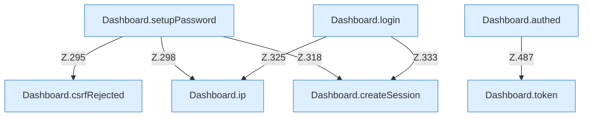

[[00 Start]] › [[Dashboard-HTTP]] › [[HTTP-Auth]]

# HTTP-Auth



```knoten
Dashboard.ip
  `ip` in `Dashboard.java`.
Dashboard.createSession
  Legt an `createSession`. Ruft `cookie`.
Dashboard.setupPassword
  `setupPassword` in `Dashboard.java`. Ruft `csrfRejected`, `json`, `ip`.
Dashboard.login
  Meldet an `login`. Ruft `ip`, `json`, `body`.
Dashboard.token
  `token` in `Dashboard.java`.
Dashboard.authed
  `authed` in `Dashboard.java`. Ruft `token`.
Dashboard.csrfRejected
  `csrfRejected` in `Dashboard.java`.
```


