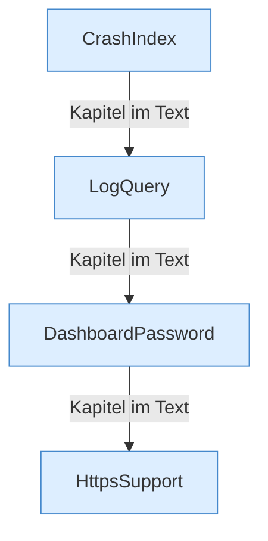

[[00 Start]] › [[Dashboard-HTTP]] › [[HTTP-Klassen]]

# HTTP-Klassen



```knoten
CrashIndex
  Sucht [[Glossar#Absturzbericht|Absturzberichte]] und liefert ihren Text.
LogQuery
  Sucht [[Glossar#Zeile|Zeilen]] im Protokoll, die zu einer Frage passen.
DashboardPassword
  Prüft das Passwort der [[Glossar#Bedienseite|Bedienseite]] und merkt sich die [[Glossar#Anmeldung|Anmeldung]].
HttpsSupport
  Baut die [[Glossar#Verschlüsselung|Verschlüsselung]] für die Verbindung zur [[Glossar#Bedienseite|Bedienseite]], wenn sie eingeschaltet ist.
```

> [!knoten] Was die Blöcke tun
> - **CrashIndex**: Sucht [[Glossar#Absturzbericht|Absturzberichte]] und liefert ihren Text.
> - **LogQuery**: Sucht [[Glossar#Zeile|Zeilen]] im Protokoll, die zu einer Frage passen.
> - **DashboardPassword**: Prüft das Passwort der [[Glossar#Bedienseite|Bedienseite]] und merkt sich die [[Glossar#Anmeldung|Anmeldung]].
> - **HttpsSupport**: Baut die [[Glossar#Verschlüsselung|Verschlüsselung]] für die Verbindung zur [[Glossar#Bedienseite|Bedienseite]], wenn sie eingeschaltet ist.

- Die Helfer daneben: Passwort, [[Glossar#Verschlüsselung|Verschlüsselung]], Protokoll und [[Glossar#Absturzbericht|Absturzberichte]].
