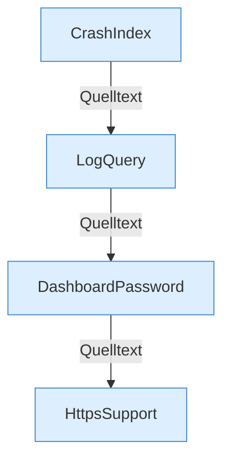

[[00 Start]] › [[Dashboard-HTTP]] › [[HTTP-Klassen]]

# HTTP-Klassen



```knoten
CrashIndex
  Sucht Crash-Reports und liefert den Text.
LogQuery
  Filtert Logzeilen für die Ansicht.
DashboardPassword
  Prüft das Dashboard-Passwort und die Sitzung.
HttpsSupport
  TLS für den HTTP-Server.
```


