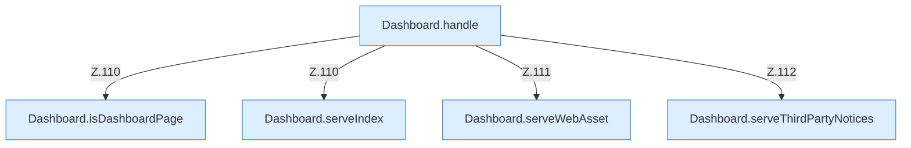

[[00 Start]] › [[Dashboard-HTTP]] › [[HTTP-Routing]]

# HTTP-Routing



```knoten
Dashboard.handle
  Ein HTTP-Kontext `/`, verzweigt nach Methode und Pfad.
Dashboard.isDashboardPage
  Prüft `isDashboardPage`.
Dashboard.serveIndex
  Liefert `serveIndex`. Ruft `sendBytes`.
Dashboard.serveWebAsset
  Liefert `serveWebAsset`. Ruft `send`, `sendBytes`.
Dashboard.serveThirdPartyNotices
  Liefert `serveThirdPartyNotices`. Ruft `send`.
```


