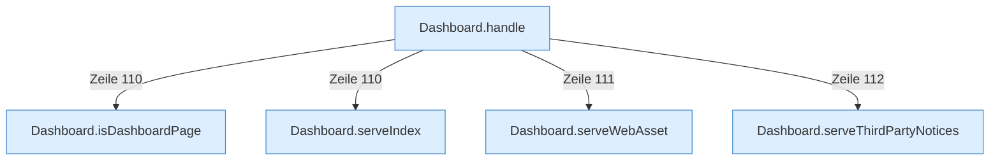

[[00 Start]] › [[Dashboard-HTTP]] › [[HTTP-Routing]]

# HTTP-Routing



```knoten
Dashboard.handle
  Nimmt eine Anfrage des Browsers an und verteilt sie an [[Glossar#Anmeldung|Anmeldung]], Zustand, Dateien oder die anderen Aufträge.
Dashboard.isDashboardPage
  Die [[Glossar#Web-Schnittstelle|Web-Schnittstelle]] prüft die [[Glossar#Bedienseite|Bedienseite]] die Seite.
Dashboard.serveIndex
  Die [[Glossar#Web-Schnittstelle|Web-Schnittstelle]] liefert die Position.
Dashboard.serveWebAsset
  Die [[Glossar#Web-Schnittstelle|Web-Schnittstelle]] liefert die Seite eine Datei der Seite.
Dashboard.serveThirdPartyNotices
  Die [[Glossar#Web-Schnittstelle|Web-Schnittstelle]] liefert fremde Bausteine die Hinweise.
```

> [!knoten] Was die Blöcke tun
> - **Dashboard.handle**: Nimmt eine Anfrage des Browsers an und verteilt sie an [[Glossar#Anmeldung|Anmeldung]], Zustand, Dateien oder die anderen Aufträge.
> - **Dashboard.isDashboardPage**: Die [[Glossar#Web-Schnittstelle|Web-Schnittstelle]] prüft die [[Glossar#Bedienseite|Bedienseite]] die Seite.
> - **Dashboard.serveIndex**: Die [[Glossar#Web-Schnittstelle|Web-Schnittstelle]] liefert die Position.
> - **Dashboard.serveWebAsset**: Die [[Glossar#Web-Schnittstelle|Web-Schnittstelle]] liefert die Seite eine Datei der Seite.
> - **Dashboard.serveThirdPartyNotices**: Die [[Glossar#Web-Schnittstelle|Web-Schnittstelle]] liefert fremde Bausteine die Hinweise.

- Sieht nach, welche Adresse der Browser aufgerufen hat, und gibt den Auftrag an den passenden Teil weiter.
