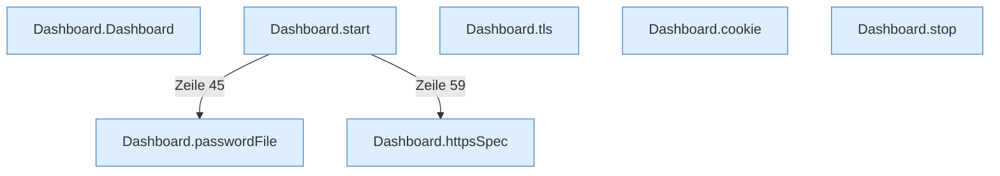

[[00 Start]] › [[Dashboard-HTTP]] › [[HTTP-Start]]

# HTTP-Start



```knoten
Dashboard.Dashboard
  Richtet die [[Glossar#Web-Schnittstelle|Web-Schnittstelle]] ein, wenn sie erzeugt wird.
Dashboard.start
  Öffnet die Tür der [[Glossar#Web-Schnittstelle|Web-Schnittstelle]].
Dashboard.tls
  Liest, ob die Verbindung zur [[Glossar#Bedienseite|Bedienseite]] verschlüsselt sein soll.
Dashboard.httpsSpec
  Liest, ob und wie die [[Glossar#Verschlüsselung|Verschlüsselung]] eingestellt ist.
Dashboard.cookie
  Liest oder setzt die [[Glossar#Anmeldung|Anmeldung]], die der Browser mitschickt.
Dashboard.stop
  Schließt die Tür der [[Glossar#Web-Schnittstelle|Web-Schnittstelle]].
Dashboard.passwordFile
  Liest oder schreibt die Datei mit dem Passwort der [[Glossar#Bedienseite|Bedienseite]].
```

> [!knoten] Was die Blöcke tun
> - **Dashboard.Dashboard**: Richtet die [[Glossar#Web-Schnittstelle|Web-Schnittstelle]] ein, wenn sie erzeugt wird.
> - **Dashboard.start**: Öffnet die Tür der [[Glossar#Web-Schnittstelle|Web-Schnittstelle]].
> - **Dashboard.tls**: Liest, ob die Verbindung zur [[Glossar#Bedienseite|Bedienseite]] verschlüsselt sein soll.
> - **Dashboard.httpsSpec**: Liest, ob und wie die [[Glossar#Verschlüsselung|Verschlüsselung]] eingestellt ist.
> - **Dashboard.cookie**: Liest oder setzt die [[Glossar#Anmeldung|Anmeldung]], die der Browser mitschickt.
> - **Dashboard.stop**: Schließt die Tür der [[Glossar#Web-Schnittstelle|Web-Schnittstelle]].
> - **Dashboard.passwordFile**: Liest oder schreibt die Datei mit dem Passwort der [[Glossar#Bedienseite|Bedienseite]].

- Öffnet diese Tür: Türnummer, [[Glossar#Verschlüsselung|Verschlüsselung]] und ein eigener [[Glossar#Thread|Thread]] für die Anfragen.
