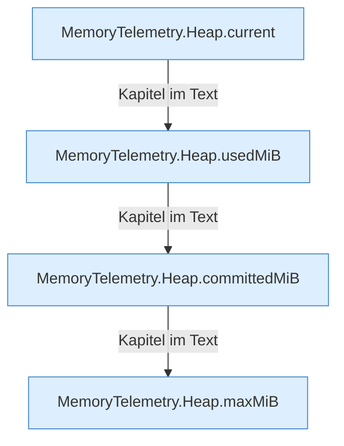

[[00 Start]] › [[Host-Betrieb]] › [[Speicher-Messung]] › [[MemoryTelemetry]] › [[Heap]]

# Heap



```knoten
MemoryTelemetry.Heap.current
  Die Messung macht hier einen einzelnen Schritt. Eine Ebene tiefer steht er genauer. `current` in `MemoryTelemetry.java`.
MemoryTelemetry.Heap.usedMiB
  Die Messung macht hier einen einzelnen Schritt. Eine Ebene tiefer steht er genauer. `usedMiB` in `MemoryTelemetry.java`. Ruft `mib`.
MemoryTelemetry.Heap.committedMiB
  Die Messung macht hier einen einzelnen Schritt. Eine Ebene tiefer steht er genauer. `committedMiB` in `MemoryTelemetry.java`. Ruft `mib`.
MemoryTelemetry.Heap.maxMiB
  Die Messung macht hier einen einzelnen Schritt. Eine Ebene tiefer steht er genauer. Begrenzt nach oben `maxMiB`. Ruft `mib`.
```

> [!knoten]- Was die Blöcke tun
> - **MemoryTelemetry.Heap.current**: Die Messung macht hier einen einzelnen Schritt. Eine Ebene tiefer steht er genauer. `current` in `MemoryTelemetry.java`.
> - **MemoryTelemetry.Heap.usedMiB**: Die Messung macht hier einen einzelnen Schritt. Eine Ebene tiefer steht er genauer. `usedMiB` in `MemoryTelemetry.java`. Ruft `mib`.
> - **MemoryTelemetry.Heap.committedMiB**: Die Messung macht hier einen einzelnen Schritt. Eine Ebene tiefer steht er genauer. `committedMiB` in `MemoryTelemetry.java`. Ruft `mib`.
> - **MemoryTelemetry.Heap.maxMiB**: Die Messung macht hier einen einzelnen Schritt. Eine Ebene tiefer steht er genauer. Begrenzt nach oben `maxMiB`. Ruft `mib`.

- Der Teil des [[Glossar#Arbeitsspeicher|Arbeitsspeichers]], den das Programm selbst für seine Daten benutzt.
