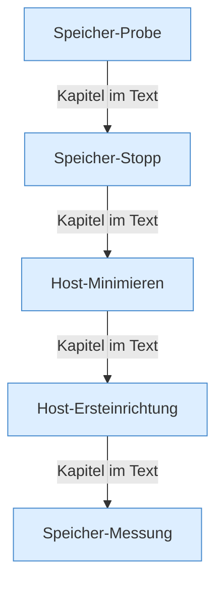

[[00 Start]] › [[Host-Betrieb]]

# Host-Betrieb



```knoten
Speicher-Probe
  Misst in einem festen Abstand, wie viel [[Glossar#Arbeitsspeicher|Arbeitsspeicher]] noch frei ist.
Speicher-Stopp
  Wird der [[Glossar#Arbeitsspeicher|Arbeitsspeicher]] knapp, schaltet das [[Glossar#Plugin|Plugin]] den [[Glossar#Spielserver|Spielserver]] aus. Eine Meldung spricht von [[Glossar#Neustart|Neustart]], neu gestartet wird aber nicht.
Host-Minimieren
  Macht den [[Glossar#Host|Host]] kleiner, solange der [[Glossar#Spielserver|Spielserver]] läuft, damit beide in den [[Glossar#Arbeitsspeicher|Arbeitsspeicher]] passen. Dazu eine Wartewelt und angepasste Startwerte.
Host-Ersteinrichtung
  Die Merkdatei, die sagt, ob der [[Glossar#Host|Host]] beim ersten Start schon umgebaut wurde.
Speicher-Messung
  Die Teile, die den [[Glossar#Arbeitsspeicher|Arbeitsspeicher]] messen, bewerten und bei einem [[Glossar#Vorfall|Vorfall]] einen Text schreiben.
```

> [!knoten] Was die Blöcke tun
> - **Speicher-Probe**: Misst in einem festen Abstand, wie viel [[Glossar#Arbeitsspeicher|Arbeitsspeicher]] noch frei ist.
> - **Speicher-Stopp**: Wird der [[Glossar#Arbeitsspeicher|Arbeitsspeicher]] knapp, schaltet das [[Glossar#Plugin|Plugin]] den [[Glossar#Spielserver|Spielserver]] aus. Eine Meldung spricht von [[Glossar#Neustart|Neustart]], neu gestartet wird aber nicht.
> - **Host-Minimieren**: Macht den [[Glossar#Host|Host]] kleiner, solange der [[Glossar#Spielserver|Spielserver]] läuft, damit beide in den [[Glossar#Arbeitsspeicher|Arbeitsspeicher]] passen. Dazu eine Wartewelt und angepasste Startwerte.
> - **Host-Ersteinrichtung**: Die Merkdatei, die sagt, ob der [[Glossar#Host|Host]] beim ersten Start schon umgebaut wurde.
> - **Speicher-Messung**: Die Teile, die den [[Glossar#Arbeitsspeicher|Arbeitsspeicher]] messen, bewerten und bei einem [[Glossar#Vorfall|Vorfall]] einen Text schreiben.

- Das [[Glossar#Plugin|Plugin]] misst den [[Glossar#Arbeitsspeicher|Arbeitsspeicher]] des [[Glossar#Host|Host]], kann den [[Glossar#Spielserver|Spielserver]] bei Druck abschalten, den Host verkleinern und ihn einmal einrichten.
