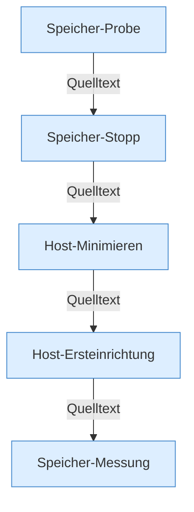

[[00 Start]] › [[Host-Betrieb]]

# Host-Betrieb



```knoten
Speicher-Probe
  Periodische Messung auf dem Thread ServerhosterPlugin-Memory.
Speicher-Stopp
  Bei Druck wantRunning aus und stopBlocking. Der Logtext sagt Emergency restart, neu gestartet wird nicht.
Host-Minimieren
  HostMinimize, Heap-Flags und die Lobby-Welt, solange der Child läuft.
Host-Ersteinrichtung
  Marker-Datei steuert, ob der Host beim Start Welten umbaut.
Speicher-Messung
  HostMemoryProbe, MemoryTelemetry, MemoryProtectionPolicy, RuntimeLimits, GcDiagnostics, Bericht und ProcessProbe.
```

- cgroup-Speicher, Notstopp nur des Child, Host-Minimize, Ersteinrichtung.
