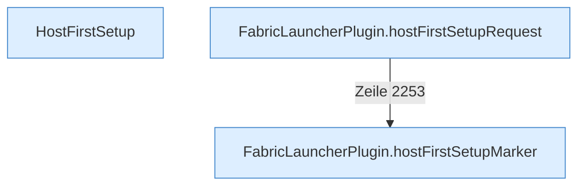

[[00 Start]] › [[Host-Betrieb]] › [[Host-Ersteinrichtung]]

# Host-Ersteinrichtung



```knoten
HostFirstSetup
  Der Stand dieser Merkdatei, von „noch nicht“ bis „fertig“. Manche Stände erlauben den Umbau, andere verlangen einen Menschen oder einen [[Glossar#Neustart|Neustart]].
FabricLauncherPlugin.hostFirstSetupMarker
  Liest oder schreibt die Merkdatei der [[Glossar#Ersteinrichtung|Ersteinrichtung]].
FabricLauncherPlugin.hostFirstSetupRequest
  Merkt den Wunsch, die [[Glossar#Ersteinrichtung|Ersteinrichtung]] von Hand anzustoßen.
```

> [!knoten] Was die Blöcke tun
> - **HostFirstSetup**: Der Stand dieser Merkdatei, von „noch nicht“ bis „fertig“. Manche Stände erlauben den Umbau, andere verlangen einen Menschen oder einen [[Glossar#Neustart|Neustart]].
> - **FabricLauncherPlugin.hostFirstSetupMarker**: Liest oder schreibt die Merkdatei der [[Glossar#Ersteinrichtung|Ersteinrichtung]].
> - **FabricLauncherPlugin.hostFirstSetupRequest**: Merkt den Wunsch, die [[Glossar#Ersteinrichtung|Ersteinrichtung]] von Hand anzustoßen.

- Die Merkdatei, die sagt, ob der [[Glossar#Host|Host]] beim ersten Start schon umgebaut wurde.
