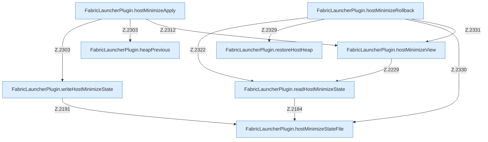

[[00 Start]] › [[Host-Betrieb]] › [[Host-Minimieren]] › [[Host-Minimieren.Teil1]]

# Host-Minimieren.Teil1



```knoten
FabricLauncherPlugin.hostMinimizeStateFile
  Betrifft den Host `hostMinimizeStateFile`.
FabricLauncherPlugin.readHostMinimizeState
  Liest `readHostMinimizeState`. Ruft `hostMinimizeStateFile`, `readState`.
FabricLauncherPlugin.writeHostMinimizeState
  Schreibt `writeHostMinimizeState`. Ruft `hostMinimizeStateFile`, `stateText`.
FabricLauncherPlugin.heapPrevious
  Betrifft den Heap `heapPrevious`.
FabricLauncherPlugin.restoreHostHeap
  Stellt wieder her `restoreHostHeap`. Ruft `hotspot`.
FabricLauncherPlugin.hostMinimizeView
  Betrifft den Host `hostMinimizeView`. Ruft `readHostMinimizeState`, `configuredHostWorld`, `preview`.
FabricLauncherPlugin.hostMinimizeApply
  Betrifft den Host `hostMinimizeApply`. Ruft `focusSlot`, `running`, `stopBlocking`.
FabricLauncherPlugin.hostMinimizeRollback
  Betrifft den Host `hostMinimizeRollback`. Ruft `readHostMinimizeState`, `restore`, `getWorldRoot`.
```


