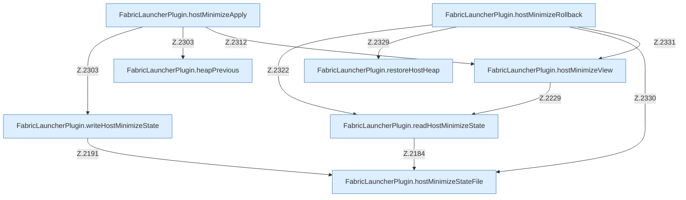

[[00 Start]] › [[Host-Betrieb]] › [[Host-Minimieren]] › [[Host-Minimieren.Teil1]]

# Host-Minimieren.Teil1



```knoten
FabricLauncherPlugin.hostMinimizeStateFile
  Das [[Glossar#Plugin|Plugin]] kümmert sich um das Verkleinern den Zustand die Datei. Im [[Glossar#Quelltext|Quelltext]] heißt das `hostMinimizeStateFile`.
FabricLauncherPlugin.readHostMinimizeState
  Das [[Glossar#Plugin|Plugin]] liest den [[Glossar#Host|Host]] das Verkleinern den Zustand. Im [[Glossar#Quelltext|Quelltext]] heißt das `readHostMinimizeState`.
FabricLauncherPlugin.writeHostMinimizeState
  Das [[Glossar#Plugin|Plugin]] schreibt den [[Glossar#Host|Host]] das Verkleinern den Zustand. Im [[Glossar#Quelltext|Quelltext]] heißt das `writeHostMinimizeState`.
FabricLauncherPlugin.heapPrevious
  Das [[Glossar#Plugin|Plugin]] macht hier einen einzelnen Schritt. Eine Ebene tiefer steht er genauer. Im [[Glossar#Quelltext|Quelltext]] heißt das `heapPrevious`.
FabricLauncherPlugin.restoreHostHeap
  Das [[Glossar#Plugin|Plugin]] stellt wieder her den [[Glossar#Host|Host]] den Programmspeicher. Im [[Glossar#Quelltext|Quelltext]] heißt das `restoreHostHeap`.
FabricLauncherPlugin.hostMinimizeView
  Das [[Glossar#Plugin|Plugin]] kümmert sich um das Verkleinern die Ansicht. Im [[Glossar#Quelltext|Quelltext]] heißt das `hostMinimizeView`.
FabricLauncherPlugin.hostMinimizeApply
  Das [[Glossar#Plugin|Plugin]] kümmert sich um das Verkleinern das Anwenden. Im [[Glossar#Quelltext|Quelltext]] heißt das `hostMinimizeApply`.
FabricLauncherPlugin.hostMinimizeRollback
  Das [[Glossar#Plugin|Plugin]] macht hier einen einzelnen Schritt. Eine Ebene tiefer steht er genauer. Im [[Glossar#Quelltext|Quelltext]] heißt das `hostMinimizeRollback`.
```

> [!knoten]- Was die Blöcke tun
> - **FabricLauncherPlugin.hostMinimizeStateFile**: Das [[Glossar#Plugin|Plugin]] kümmert sich um das Verkleinern den Zustand die Datei. Im [[Glossar#Quelltext|Quelltext]] heißt das `hostMinimizeStateFile`.
> - **FabricLauncherPlugin.readHostMinimizeState**: Das [[Glossar#Plugin|Plugin]] liest den [[Glossar#Host|Host]] das Verkleinern den Zustand. Im [[Glossar#Quelltext|Quelltext]] heißt das `readHostMinimizeState`.
> - **FabricLauncherPlugin.writeHostMinimizeState**: Das [[Glossar#Plugin|Plugin]] schreibt den [[Glossar#Host|Host]] das Verkleinern den Zustand. Im [[Glossar#Quelltext|Quelltext]] heißt das `writeHostMinimizeState`.
> - **FabricLauncherPlugin.heapPrevious**: Das [[Glossar#Plugin|Plugin]] macht hier einen einzelnen Schritt. Eine Ebene tiefer steht er genauer. Im [[Glossar#Quelltext|Quelltext]] heißt das `heapPrevious`.
> - **FabricLauncherPlugin.restoreHostHeap**: Das [[Glossar#Plugin|Plugin]] stellt wieder her den [[Glossar#Host|Host]] den Programmspeicher. Im [[Glossar#Quelltext|Quelltext]] heißt das `restoreHostHeap`.
> - **FabricLauncherPlugin.hostMinimizeView**: Das [[Glossar#Plugin|Plugin]] kümmert sich um das Verkleinern die Ansicht. Im [[Glossar#Quelltext|Quelltext]] heißt das `hostMinimizeView`.
> - **FabricLauncherPlugin.hostMinimizeApply**: Das [[Glossar#Plugin|Plugin]] kümmert sich um das Verkleinern das Anwenden. Im [[Glossar#Quelltext|Quelltext]] heißt das `hostMinimizeApply`.
> - **FabricLauncherPlugin.hostMinimizeRollback**: Das [[Glossar#Plugin|Plugin]] macht hier einen einzelnen Schritt. Eine Ebene tiefer steht er genauer. Im [[Glossar#Quelltext|Quelltext]] heißt das `hostMinimizeRollback`.

- Ein weiterer Abschnitt derselben Übersicht.
