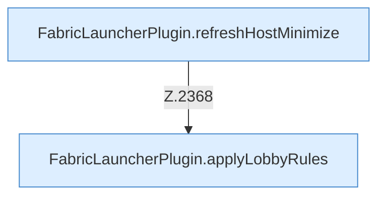

[[00 Start]] › [[Host-Betrieb]] › [[Host-Minimieren]] › [[Host-Minimieren.Teil2]]

# Host-Minimieren.Teil2



```knoten
FabricLauncherPlugin.refreshHostMinimize
  Das [[Glossar#Plugin|Plugin]] lädt neu den [[Glossar#Host|Host]] das Verkleinern. Im [[Glossar#Quelltext|Quelltext]] heißt das `refreshHostMinimize`.
FabricLauncherPlugin.applyLobbyRules
  Das [[Glossar#Plugin|Plugin]] wendet an die Wartewelt. Im [[Glossar#Quelltext|Quelltext]] heißt das `applyLobbyRules`.
```

> [!knoten]- Was die Blöcke tun
> - **FabricLauncherPlugin.refreshHostMinimize**: Das [[Glossar#Plugin|Plugin]] lädt neu den [[Glossar#Host|Host]] das Verkleinern. Im [[Glossar#Quelltext|Quelltext]] heißt das `refreshHostMinimize`.
> - **FabricLauncherPlugin.applyLobbyRules**: Das [[Glossar#Plugin|Plugin]] wendet an die Wartewelt. Im [[Glossar#Quelltext|Quelltext]] heißt das `applyLobbyRules`.

- Ein weiterer Abschnitt derselben Übersicht.
