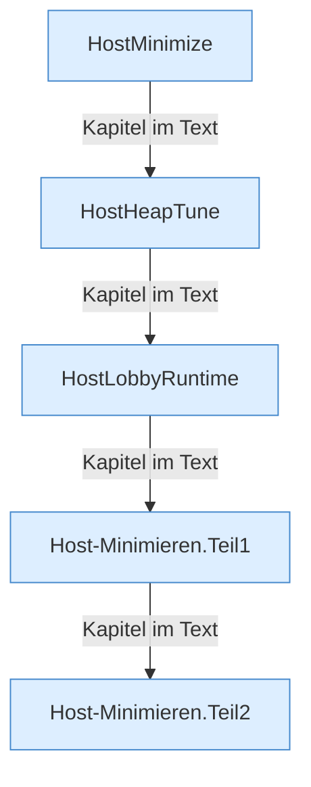

[[00 Start]] › [[Host-Betrieb]] › [[Host-Minimieren]]

# Host-Minimieren



```knoten
HostMinimize
  Wendet das Verkleinern an oder nimmt es zurück. [[Glossar#Spieler|Spieler]] können dabei auf dem [[Glossar#Host|Host]] blockiert sein.
HostHeapTune
  Setzt die Speicherwerte, mit denen der verkleinerte [[Glossar#Host|Host]] starten soll.
HostLobbyRuntime
  Hält auf dem [[Glossar#Host|Host]] eine kleine Wartewelt, während der [[Glossar#Spielserver|Spielserver]] läuft.
Host-Minimieren.Teil1
  Ein weiterer Abschnitt derselben Übersicht.
Host-Minimieren.Teil2
  Ein weiterer Abschnitt derselben Übersicht.
```

> [!knoten] Was die Blöcke tun
> - **HostMinimize**: Wendet das Verkleinern an oder nimmt es zurück. [[Glossar#Spieler|Spieler]] können dabei auf dem [[Glossar#Host|Host]] blockiert sein.
> - **HostHeapTune**: Setzt die Speicherwerte, mit denen der verkleinerte [[Glossar#Host|Host]] starten soll.
> - **HostLobbyRuntime**: Hält auf dem [[Glossar#Host|Host]] eine kleine Wartewelt, während der [[Glossar#Spielserver|Spielserver]] läuft.
> - **Host-Minimieren.Teil1**: Ein weiterer Abschnitt derselben Übersicht.
> - **Host-Minimieren.Teil2**: Ein weiterer Abschnitt derselben Übersicht.

- Macht den [[Glossar#Host|Host]] kleiner, solange der [[Glossar#Spielserver|Spielserver]] läuft, damit beide in den [[Glossar#Arbeitsspeicher|Arbeitsspeicher]] passen. Dazu eine Wartewelt und angepasste Startwerte.
