[[00 Start]] › [[Plugin-Kern]] › [[Host-Pfade]]

# Host-Pfade

```mermaid
flowchart TD
  n1["FabricLauncherPlugin.getWorldRoot"]:::internal-link
  n2["FabricLauncherPlugin.upstream"]:::internal-link
  n3["FabricLauncherPlugin.dashboardTls"]:::internal-link
  n4["FabricLauncherPlugin.runningPluginJar"]:::internal-link
  n5["FabricLauncherPlugin.hostProtectedPaths"]:::internal-link
  n6["FabricLauncherPlugin.configuredPath"]:::internal-link
  n7["FabricLauncherPlugin.configuredHostWorld"]:::internal-link
  n8["FabricLauncherPlugin.javaBin"]:::internal-link
  n9["FabricLauncherPlugin.str"]:::internal-link
  n10["FabricLauncherPlugin.isWindows"]:::internal-link
  n5 -->|"Zeile 2168"| n1
  n6 -->|"Zeile 2224"| n1
  n7 -->|"Zeile 2260"| n1
  n8 -->|"Zeile 2670"| n10
  classDef internal-link fill:#ddeeff,stroke:#4488cc
  classDef befund fill:#f88
  style n2 fill:#f88,stroke:#900
```



```knoten
FabricLauncherPlugin.getWorldRoot
  Das [[Glossar#Plugin|Plugin]] liefert die [[Glossar#Spielwelt|Spielwelt]] den Anfang.
FabricLauncherPlugin.upstream
  Das [[Glossar#Plugin|Plugin]] macht hier einen einzelnen Schritt. Eine Ebene tiefer steht er genauer. Auffällig: im normalen Betrieb ruft das niemand auf. Das nennt man [[Glossar#Ungenutzt|Ungenutzt]].
FabricLauncherPlugin.dashboardTls
  Liest, ob die [[Glossar#Bedienseite|Bedienseite]] verschlüsselt erreichbar sein soll.
FabricLauncherPlugin.runningPluginJar
  Das [[Glossar#Plugin|Plugin]] prüft, ob läuft, das Plugin die [[Glossar#Programmdatei|Programmdatei]].
FabricLauncherPlugin.hostProtectedPaths
  Die Ordner des [[Glossar#Host|Host]], die nicht gelöscht oder überschrieben werden dürfen.
FabricLauncherPlugin.configuredPath
  Liest einen Ordner so, wie er in den [[Glossar#Einstellungen|Einstellungen]] steht.
FabricLauncherPlugin.configuredHostWorld
  Liest, welche [[Glossar#Spielwelt|Spielwelt]] der [[Glossar#Host|Host]] benutzen soll.
FabricLauncherPlugin.javaBin
  Liefert das Java-Programm, mit dem der [[Glossar#Spielserver|Spielserver]] gestartet wird.
FabricLauncherPlugin.str
  Das [[Glossar#Plugin|Plugin]] macht hier einen einzelnen Schritt. Eine Ebene tiefer steht er genauer.
FabricLauncherPlugin.isWindows
  Das [[Glossar#Plugin|Plugin]] prüft Windows.
```

> [!knoten] Was die Blöcke tun
> - **FabricLauncherPlugin.getWorldRoot**: Das [[Glossar#Plugin|Plugin]] liefert die [[Glossar#Spielwelt|Spielwelt]] den Anfang.
> - **FabricLauncherPlugin.upstream**: Das [[Glossar#Plugin|Plugin]] macht hier einen einzelnen Schritt. Eine Ebene tiefer steht er genauer. Auffällig: im normalen Betrieb ruft das niemand auf. Das nennt man [[Glossar#Ungenutzt|Ungenutzt]].
> - **FabricLauncherPlugin.dashboardTls**: Liest, ob die [[Glossar#Bedienseite|Bedienseite]] verschlüsselt erreichbar sein soll.
> - **FabricLauncherPlugin.runningPluginJar**: Das [[Glossar#Plugin|Plugin]] prüft, ob läuft, das Plugin die [[Glossar#Programmdatei|Programmdatei]].
> - **FabricLauncherPlugin.hostProtectedPaths**: Die Ordner des [[Glossar#Host|Host]], die nicht gelöscht oder überschrieben werden dürfen.
> - **FabricLauncherPlugin.configuredPath**: Liest einen Ordner so, wie er in den [[Glossar#Einstellungen|Einstellungen]] steht.
> - **FabricLauncherPlugin.configuredHostWorld**: Liest, welche [[Glossar#Spielwelt|Spielwelt]] der [[Glossar#Host|Host]] benutzen soll.
> - **FabricLauncherPlugin.javaBin**: Liefert das Java-Programm, mit dem der [[Glossar#Spielserver|Spielserver]] gestartet wird.
> - **FabricLauncherPlugin.str**: Das [[Glossar#Plugin|Plugin]] macht hier einen einzelnen Schritt. Eine Ebene tiefer steht er genauer.
> - **FabricLauncherPlugin.isWindows**: Das [[Glossar#Plugin|Plugin]] prüft Windows.

- Wo die [[Glossar#Spielwelt|Spielwelt]] liegt, welches Java benutzt wird, wo die [[Glossar#Programmdatei|Programmdatei]] des [[Glossar#Plugin|Plugins]] liegt, und welche Ordner geschützt sind.
